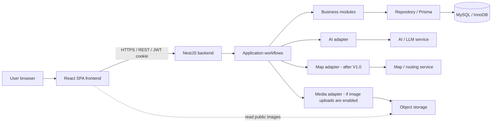
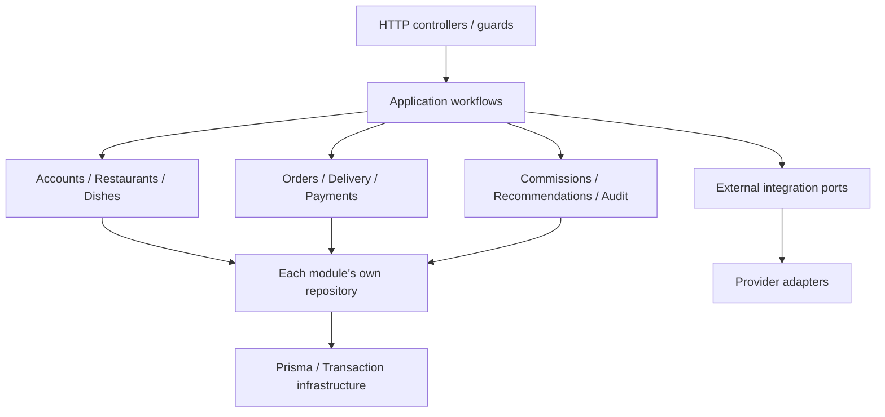
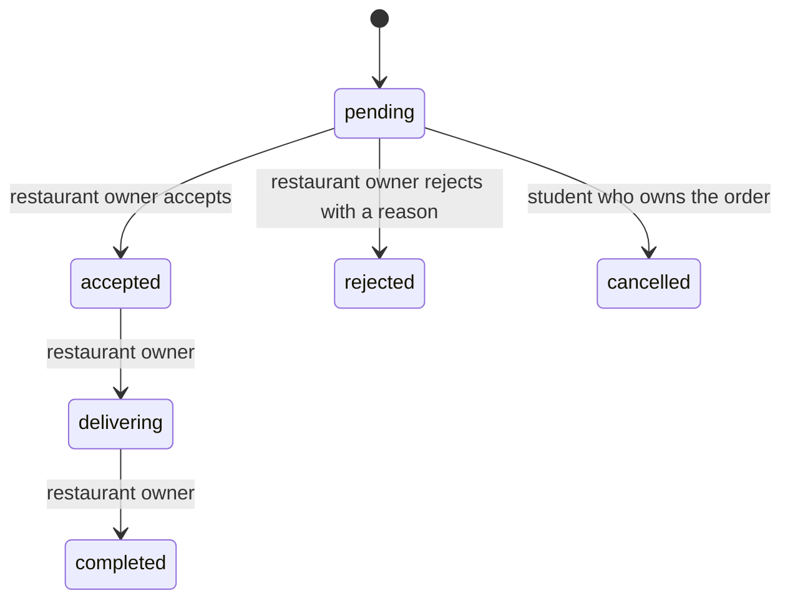

# System Architecture — Hoa Lac Food Ordering Platform

> October25 COD cutover: [approved operating/API/history contract](cod-ordering.md) supersedes new-order cash/QR selection, QR authoring/review and platform voucher issuance/redemption. Legacy payment/refund and accepted voucher subsidy obligations remain. Prior verification is historical.

> **Purpose:** describe the overall technical design, where each responsibility belongs, and which dependencies are allowed. Implementers, including AI coding assistants, must preserve these boundaries when adding or changing code.
>
> **Status:** commercial V1.0 target revised October 18, 2026. [Current implementation/evidence](implementation-status.md) remains partly legacy; this task changes documentation only.

## 1. Sources and Document Scope

This document derives from [requirements](requirements.md) and the checked-in frontend/backend scaffold. The [documentation map](README.md) maintains navigation; manifests and lockfiles determine installed tools and versions.

The technology choices established in the requirements are **Vite + React + TypeScript, Tailwind CSS, NestJS + TypeScript, REST, JWT, Prisma, and MySQL/InnoDB**. The architecture is a **modular monolith** with three logical tiers: presentation, business logic, and data.

Additional decisions in this document—such as polling, service organization, transaction locking, JWT cookie storage, and an image storage adapter—are **proposed implementation designs**, not capabilities already present in the source code. AI, map, image storage, and infrastructure providers remain undecided.

This document does not fully define tables/columns, endpoints, DTOs, screens, or AI prompts. Those details belong in [database.md](data/database.md), [api_contract.md](data/api_contract.md), [docs/ui/ui_convertion.md](ui/ui_convertion.md), and [ai_integration.md](ai_integration.md). If a design requires changing a business rule, agree on the corresponding change to [requirements.md](requirements.md) first; do not silently change the rule through code.

### 1.1. Verified Current State

[Implementation status](implementation-status.md) owns the inspected October 18 source baseline and evidence classification. Legacy auth/role requests and fixture discovery exist; restaurant/menu CRUD seen in an earlier dirty snapshot is absent from the final inspected source. Public discovery, shared buyer/manager identity, singleton MFA Admin and opening applications remain target work. MySQL 9.2.0, Prisma configuration/adapter and existing migrations remain unchanged.

## 2. Overall Architecture



The frontend runs in the browser; it is not a separate server-side business tier. The backend is **one NestJS application deployed as a unit**. Its modules share one MySQL database but cannot access one another's data freely. The V1.0 does not require microservices, a message broker, Redis, or a driver dispatch system.

Production direction: serve the frontend and `/api` under the same origin through a reverse proxy. MySQL resides on a private network and is accessible only to the backend. Specific hosting choices belong in the deployment document.

### 2.1. Responsibility Boundaries

| Component | Responsible for | Must not decide or perform |
| --- | --- | --- |
| Frontend | Rendering, collecting input, usability-oriented validation, holding the cart, sending commands, and reading state | Final prices, delivery fees, commissions, access rights, or whether a state transition succeeded |
| HTTP controller / guard | Parsing/validating DTOs, validating JWTs, preliminary capability checks, calling workflows, mapping results/errors to HTTP | Monetary formulas, state rules, Prisma queries, or direct AI calls to place orders |
| Application workflow | Coordinating a use case, checking resource permissions through services, opening a transaction, invoking modules, and recording audit entries | Bypassing the data-owning service or duplicating business formulas |
| Business module | Owning its domain rules for orders, delivery, payments, commissions, etc.; exposing public services/ports | Writing directly to another module's tables |
| Repository / Prisma | Queries, locks, conditional updates, and operations within the supplied transaction | Inferring business authorization from client-supplied data |
| MySQL | Durable storage; foreign keys, uniqueness, integrity, and transactions | Replacing current capability/ownership checks or service-level transition decisions |
| AI / maps / image storage | Providing results through controlled adapters | Authoritatively changing order state or independently determining financial obligations |

## 3. Modules, Data Ownership, and V1.0 Scope

The service names below are proposed architectural contracts, not claims that these classes already exist. “Data ownership” means that only the owning module may write that data; other modules receive results through public services/ports.

| Module | Owned data | Proposed public services/ports | V1.0 and expansion |
| --- | --- | --- | --- |
| `accounts` | Accounts, password hashes, sole Admin authority/MFA, contact information, account status | `AccountService`, `AuthService` | **V1.0**: ordinary-user registration/login, JWT, computed capabilities and sole Admin MFA/recovery; no driver role |
| `restaurants` | Restaurant profiles, opening hours, active/order-accepting status, restaurant–owner relationships | `RestaurantService`, `RestaurantAccessService` | **V1.0**: partner management and order eligibility; one restaurant maximum per account, each restaurant with one responsible current manager |
| `dishes` | Dishes, categories, current prices, visibility/availability, image references | `DishCatalogService`, `DishManagementService` | **V1.0**: browsing/search, ownership-scoped CRUD, hiding dishes with order history |
| `delivery` | Fixed pickup points, surveyed distances/fees per restaurant; policies and quote versions | `DeliveryQuoteService`, `DeliveryPolicyService` | **V1.0**: fixed pickup points; **after V1.0**: free-form addresses, map pins, route distance, and fee tiers |
| `orders` | Orders, item snapshots, totals, status, transition history, order-creation idempotency records | `OrderService`, `OrderQueryService`, `OrderPricingPolicy` | **V1.0**: creation, acceptance/rejection, delivery, completion, cancellation while pending, and tracking; **V0.5**: history/recovery screens; **V1.1**: reorder |
| `payments` | Order payment methods/statuses, confirming actor/time; restaurant QR configuration when introduced | `PaymentService` | **V0.5**: cash confirmation; **V0.6/V1.0**: direct QR and refund recording |
| `commissions` | Restaurant rates, base entries, adjustments, settlements, manual collection receipts | `CommissionPolicyService`, `CommissionService`, `SettlementService` | **V0.5**: unique base accrual; **V0.7/V1.0**: manual reconciliation, receipts and approved reports |
| `recommendations` | Candidate filtering/output validation rules and recommendation configuration; no conversation or training data storage | `RecommendationService`, `AiGateway` | **V1.0**: recommendations from eligible dishes; **after V1.0 / Should**: random selection |
| `audit` | Actor, timestamp, action, target, and changes with sensitive data filtered out | `AuditService` | **V1.0**: audit restaurant/dish changes, status changes, payments, commission adjustments, and collections |
| `media` | Asset metadata, storage keys, usage/deletion state if uploads are implemented | `MediaService`, `ImageStoragePort` | **As needed for V1.0**: dish images are optional; provider undecided |
| `support` | Order-linked requests, messages and review history under DEC-08 | `SupportService` | **V0.7/V1.0 required** |
| `reviews`, `favorites` | Reviews after completed orders; user favorites | Corresponding services | **After V1.0 / Could**; not implemented by default |

The V1.0 cart belongs to the frontend and represents purchase intent only. A guest can build a cart before login. Login preserves its non-sensitive draft; safe internal return navigation restores checkout, refreshes current data and requires a new explicit order confirmation. Login must never submit an order automatically. Isolate private checkout drafts and unknown-outcome keys by account; do not leak them on logout/account switching. A created order belongs to the backend; losing browser state must not lose the order.

Tracking, durable history screens and recovery are required from V0.5. The [October25 scoped purchase extension](ui/purchase-history-figma.md) enables reorder; its October29 revision requires one restaurant per browser cart and one order per new confirmation. Valid additions from another restaurant atomically replace the cart. Legacy uncertain batch recovery remains supported with original quotes/keys/results. No later scope label defers snapshots, audit or financial constraints.

### 3.1. New capability boundaries

`onboarding` owns applications/terms consent/reviews; `accounts` owns identity/sole authority/MFA/user availability; `restaurants` owns the unique owner relationship and sell readiness. Application approval and manual partner creation coordinate these public services and audit in one transaction, never replace ownership with an exclusive Owner role. See [onboarding](onboarding.md), [security](account-security.md) and [forward migration](data/migration-plan.md).

Public catalog reads have no session dependency and use allowlisted projections; private account, application, order/contact and financial queries keep explicit scope. Public discovery can show closed/sold-out data but never hidden/inactive/setup-required partners. Setup approval is not sell permission.

## 4. Dependency Rules

### 4.1. Allowed Call Direction



1. `http → workflows → public services → repositories → Prisma` is the main dependency direction. Domain policies must not import controllers, Prisma, provider SDKs, or frontend code.
2. The V1.0 uses `workflows/` to coordinate multiple modules. Business modules must not directly import another module's implementation or call back into a workflow. This prevents cycles such as `orders ↔ payments ↔ commissions`.
3. Each module exposes its public contract through `public.ts`. Do not deep-import another module's repository, internal entities, or Prisma models. These public services are in-process calls, not HTTP microservices.
4. Controllers must not inject `PrismaService`, repositories, or provider SDKs. They call the appropriate workflow; sensitive reads also undergo access-scope checks.
5. Workflows receive a `TransactionContext` only to pass it along, not to write queries themselves. Each participating module's repository uses the same transaction client.
6. Data-owning modules expose narrow operations such as `confirmReceipt`, `createBaseForCompletedOrder`, and `getOrderableDishes`; they must not expose generic operations allowing arbitrary table or state writes.
7. The frontend uses only API contracts/DTOs. It must not import the Prisma client, persistence models, or server code. Shared frontend components must not depend back on a business feature.
8. AI must not have tools to write to the database, confirm payments, change status, or create orders. AI output is untrusted until validated by the backend.

### 4.2. Key Coordination Contracts

| Workflow | Services called and their purpose |
| --- | --- |
| `OrderWorkflow.create` | Restaurant: order eligibility; Dishes: current dishes/prices; Delivery: valid quote; Commissions: current rate; Orders: totals and snapshots; Payments: COD not_tracked (zero total not_required); Audit: recording |
| `OrderWorkflow.transition` | RestaurantAccess/Orders: permissions and state; Orders: transition; Payments: refund obligations when applicable; Commissions: base entry on completion; Audit: changes |
| `PaymentWorkflow.confirm` | Orders: read and lock order context; RestaurantAccess: verify owner; Payments: legacy-only receipt confirmation; COD rejected; Audit: record the action |
| `RecommendationWorkflow.suggest` | Restaurant/Dishes/Delivery: build eligible candidates; Recommendations + AiGateway: rank/recommend; revalidate returned IDs |
| `RestaurantAdminWorkflow.delete` | Restaurants: lock and authorize; Orders/Settlements: check history; Dishes/Delivery/Payments/Commissions: remove deletable configuration through owning services; Restaurants: delete restaurant/management relationship or deactivate; Audit: result |
| `SettlementWorkflow` | RestaurantAccess: restaurant scope; Commissions/Settlements: entry grouping, adjustments, receipts; Audit: reasons and actors |

Owner permissions come from the current relationship owned by `restaurants`. Do not trust client-supplied `restaurant_id`, `student_id`, roles, or restaurant lists as proof of access. Recipient snapshots on an order are historical data; account profile changes must not modify them.

**Code placement examples:** change delivery fees in `delivery`; order total formulas in `orders`; commission rates and rounding in `commissions`; add an AI provider in an adapter; add an order-acceptance screen in the frontend `orders` feature. Do not put these business rules in `common/`, controllers, or React components.

## 5. Critical Flows

### 5.1. Order Creation

```mermaid
sequenceDiagram
    participant F as Frontend
    participant W as OrderWorkflow
    participant S as Business services
    participant D as MySQL
    F->>W: Order payload + quote confirmation + idempotency key
    W->>W: Authenticate actor, validate and normalize payload
    W->>D: Look up prior result; start transaction if creation is needed
    W->>S: Lock/check restaurant, dishes, quote, and rate
    S->>D: Read current data in the same transaction
    W->>S: Calculate amounts and compare with customer agreement
    W->>S: Save order, items, unpaid payment, history, audit, idempotency
    S->>D: Write within the same transaction
    W->>D: Commit
    W-->>F: Order ID + snapshot + authoritative state
```

- The frontend submits dish IDs/quantities, pickup point, recipient details, payment method, and the agreed quote. Any client-supplied total is not authoritative.
- The backend obtains prices, restaurant/dish eligibility, fees, and rates from their owning services. The V1.0 looks up surveyed configuration for the restaurant–pickup-point pair; missing data prevents order confirmation.
- Agreed prices and fees are compared with server data. If they changed, return a conflict requiring customer reconfirmation; do not silently charge the new amount. The server must validate the quote ID/version or fingerprint, rather than trusting client-supplied amounts.
- `OrderPricingPolicy` calculates integer VND amounts with safe-range checks; do not use binary floating-point arithmetic for money. `total = subtotal + delivery_fee`.
- Snapshot dish names/prices, fees, surveyed or route distance, pickup point/recipient details, commission rate, and data needed to explain the quote. Later changes to current data must not change existing orders.
- Create the order as `pending` and payment as `unpaid`. Return success only after commit.

After the V1.0, geocoding/routing API calls run **before the transaction**. Backend-issued quotes expire and are bound to the correct restaurant, location, and policy version. Revalidate quote validity and configuration within the transaction. If the provider fails and no valid quote exists, do not confirm the order or invent distance/fees. Manual ordering remains available where valid delivery data is still sufficient, such as surveyed fixed pickup points.

### 5.2. Order State Transitions



`OrderService` owns this state machine. The workflow authenticates the actor, locks the order, reads the latest state, checks ownership, and calls the service. Administrators do not automatically gain permission to change order status or confirm payments: the requirements assign these operations to restaurant owners.

Resubmitting the current status is a no-op after authorization: return the current state without adding history, a change audit entry, or commission. Requesting an earlier state after the order has progressed is a conflict, not a valid transition. Once an order has been accepted, students have no self-service cancellation API; order-linked support is required by V0.7/V1.0.

### 5.3. Completion and Commission Generation

Within **one transaction**, the workflow applies `delivering → completed`, records history, calls `CommissionService.createBaseForCompletedOrder`, and writes the audit entry. The commissions module receives completed-order context constructed by the workflow from locked data, not client-declared amounts.

Commission uses the **dish subtotal and commission rate snapshotted on the order**, excluding delivery fees. Represent the rate as an exact decimal or a scaled integer using the scale agreed in [database.md](data/database.md); round half-up to the nearest VND. Do not use the restaurant's current rate to recalculate an old order.

Each order has at most one base entry, enforced by a unique constraint. If commission creation fails, roll back completion as well. Do not move commission creation into an after-commit callback or an event stored only in memory.

Payment state is independent of order state. The requirements do not make `paid` a prerequisite for `completed`, so the architecture must not add that condition. Commission arises from completion even when payment confirmation is recorded at another time.

### 5.4. Payment Confirmation

1. The restaurant owner verifies receipt of funds outside the system, then submits a confirmation command.
2. `PaymentWorkflow` checks permissions for the restaurant/order, locks the order context and payment, calls `PaymentService`, and records audit data in one transaction.
3. Duplicate confirmation produces no second effect. Payment confirmation does not automatically complete the order, regenerate commission, or record a commission collection receipt for the platform.

V0.5 accepts cash; V0.6 adds QR/refunds required by V1.0. QR payments go directly to the restaurant; scanning a QR code or a student reporting a transfer must not set payment to `paid`.

When QR is introduced, a cancelled/rejected order that has already been paid must become `refund_pending` within the state-transition transaction. If receipt of funds is confirmed late, after cancellation/rejection, `PaymentService` records the payment and the `refund_pending` obligation in the same transaction; it does not reopen the order. The restaurant refunds externally and then records `refunded`. This is a proposed coordination design for BR12–BR14; evidence and confirmation conditions must be specified in the API and testing documents before QR implementation.

### 5.5. Dish Recommendations

1. The workflow obtains real, available dishes from ready, active, open restaurants accepting orders and able to deliver to the selected point; it applies the budget constraints relevant to the request.
2. Send only the minimum candidate data to AI: IDs, dish descriptions, relevant prices/costs, and filtered preferences. Do not send names, phone numbers, detailed addresses, or coordinates that identify the delivery address.
3. AI suggests IDs/rankings within the candidate set. Before returning results, the backend validates the schema, membership in the submitted set, and current eligibility; displayed prices/fees come from backend data.
4. On AI errors, timeouts, or invalid dishes, discard invalid results and show an appropriate message. Browsing and manual ordering remain available; AI responses are not delivery or order quotes.
5. When users select dishes and place an order, always use the normal order-creation flow to revalidate them.

Do not hold a transaction while waiting for AI. Set an end-to-end deadline supporting the target of 95% within 5 seconds, ending the request and prompting retry at 10 seconds; these are targets to measure, not achieved results. Do not store conversations or log prompts containing personal information.

## 6. Transaction Boundaries and Integrity

The infrastructure-level `TransactionManager` uses Prisma transactions on MySQL/InnoDB. Workflows open transactions; all participating write services receive the same `TransactionContext`. A service must not open an independent transaction when already participating in a shared one.

| Operation | Must commit or roll back together | Outside the transaction |
| --- | --- | --- |
| Create order | Successful idempotency record, order, items/snapshots, unpaid payment, initial state, audit | AI/map calls, image uploads, displaying results |
| Change status | Locked state check, status/version update, history, audit, and any refund obligation | UI refresh, external notifications |
| Complete order | Entire completed transition and the unique base commission | Subsequent manual commission collection |
| Confirm payment/refund | Payment, actor/time/evidence references, audit; order-state check under the same lock | External movement of money |
| Create settlement | Settlement and assignment of all selected entries, same-restaurant and unassigned checks, audit | Exported reports |
| Record commission receipt/adjustment | Receipt or adjustment, duplicate-submission protection, reason/actor, audit; stored totals if any | Actual transfer/payment from the restaurant |
| Edit restaurant/dish/policy | Data changes, relevant version increments, audit | Uploading/deleting image blobs |
| Delete restaurant without history | Check for no orders/settlements; delete eligible menu/configuration through owning services, management relationship, and restaurant; audit | Deleting images from storage after commit |

**Required business audit records belong in the same transaction as the change.** If the audit write fails, the change fails. Operational logging, such as connection errors and latency, is a separate concern; a temporary log collector failure must not by itself fail business operations.

Deleting a restaurant revokes only its management relationship; it preserves the ordinary account, buyer access and historical actor references. Audit must retain the deleted target's identity without cascading away its history. Newly uploaded images without references require orphan cleanup; image deletion after commit must check for remaining references and support safe retries.

The minimum database constraints to specify in [database.md](data/database.md) are:

- Foreign keys protect references; do not cascade-delete order history, payments, or the commission ledger.
- Uniqueness for `(actor_id, operation, idempotency_key)` on order creation and for base commission per order. Adjustments must not share a blanket “one entry per order” constraint because an order may have multiple adjustments.
- Each commission entry belongs to at most one settlement. Validate that entry and settlement belong to the same restaurant while locking the data, and reinforce this with appropriate referential constraints where possible.
- Money and quantity values have valid ranges; receipts/adjustments retain history rather than overwriting the past.
- Snapshots exist independently of current names/prices. Dishes referenced by orders may only be hidden; restaurants with orders or settlements may only be deactivated.

If reliable external actions are needed after commit, introduce a **transactional outbox** and idempotent worker. This is an extension point, not a prerequisite for V1.0 polling and synchronous commission recording. A MySQL transaction cannot roll back an external upload or a movement of money that has already occurred.

## 7. Concurrency and Duplicate Requests

### 7.1. Locks and Versions

The proposed V1.0 uses InnoDB row locks for critical mutations, together with conditional updates on state/version and unique constraints. If locking requires SQL alongside Prisma, parameterize it and keep it in repositories, not controllers or workflows.

To simplify coordination at V1.0 scale, writes affecting the same restaurant lock the **restaurant row as the coordination point** before locking child data. Order creation, dish price/availability changes, fee/rate changes, ownership reassignment, and restaurant deletion/deactivation must follow the same convention. This closes the gap between checking order eligibility and persisting an order while relevant data is concurrently changed or deleted.

Use database §10 as the canonical complete lock order: affected accounts ascending → request key → sole authority/application groups where required → restaurants ascending → orders/dishes → point/delivery → commission policy → payment → settlements → entries. Lock only required groups, using the fixed table/ID ordering there. Approval/manual create check the unique ownership cap under the same account locks; never acquire account locks after restaurant locks.

This choice is straightforward to verify but limits concurrent writes within one restaurant. If measurements show significant contention, narrow the locks using versions/conditional writes; preserve all invariants and test races before replacing the strategy. A mutex inside one Node.js process must not be the sole protection mechanism.

### 7.2. Required Scenarios

| Scenario | Mechanism | Result |
| --- | --- | --- |
| Owner accepts while student cancels | Same restaurant/order locks; read latest state and update conditionally on pending/version | One transition wins; the other request receives a conflict and current state |
| Two requests accept the same order | Lock and check state | One acceptance; the other request is a no-op if the current state is still accepted |
| Resubmit completed | Check state before effects; unique base commission | No additional history/commission; return current state |
| Submit delivering after completed | State machine prohibits moving backward | Conflict; no data change |
| Change price/hide a dish or deactivate a restaurant while creating an order | Same restaurant lock; reread relevant records within the transaction | Create from valid data at the serialization point or reject; never accept from unchecked stale data |
| Two settlements select the same entry | Restaurant/entry locks; single-settlement constraint | Assign the entry once; do not duplicate receivables |
| Confirm payment while cancelling/rejecting | Same restaurant/order locks before payment | Final state reflects both the order outcome and any refund obligation |

### 7.3. Order-Creation Idempotency

- The frontend generates a key for **one order intent** and retains it through timeouts/reloads until the result is known. Retrying the same intent reuses the key; accepting a new quote or changing the payload starts a new key.
- The backend scopes the key to the authenticated actor and operation, storing a fingerprint of the normalized payload. The fingerprint includes dishes/quantities, pickup point, recipient details, payment method, and the agreed quote version/content.
- Same key and fingerprint after success: return that actor's original order, without using new prices to create another order. Same key with a different fingerprint: conflict.
- Two unresolved requests with the same key: the database unique constraint determines the winner. Commit the key, fingerprint, and order reference together; the losing request waits for a bounded period or rereads after the winning transaction ends. If the outcome remains unknown, return a retryable error requiring the **same key**.
- Rollback leaves neither a partial order nor a successful idempotency record. If commit succeeds but the response is lost, retry finds and returns the created order.
- Proposed V1.0 retention: keep successful keys for the order's retention lifetime; do not use a short TTL that could let an old retry create a new order.

Deadlocks/lock timeouts are transient errors: retry the entire transaction a bounded number of times, for example up to 3 attempts with backoff. Do not retry authorization errors, invalid data, or invalid transitions. Do not place external side effects inside retried transaction code.

## 8. Updating Status in the UI

**The V1.0 uses REST polling**, without SSE or WebSocket.

- Active order-tracking pages and restaurant order lists poll approximately **every 5 seconds** while the tab is visible. This is an initial value to validate under actual load.
- Do not start another request while the previous one is unfinished. On network errors, apply bounded backoff, for example up to 30 seconds; pause while hidden/offline and refresh immediately on return.
- After accepting, cancelling, or changing status, use the server response and refresh related data immediately. Do not present financial state or completion as successful before the response.
- Stop order-status polling at terminal states (`completed`, `cancelled`, `rejected`). If payment/refund tracking is still needed, use a separate query until that state settles; do not merge the two lifecycles.
- On reload, fetch the order from the backend by ID. Show update time/connection errors so users do not mistake stale data for current state.
- Include a version or update timestamp so the frontend can reject older responses arriving late. Every polling endpoint still checks ownership; it must not return another user's or restaurant's orders.

Polling fits a small number of V1.0 restaurants with minimal infrastructure. Reconsider **SSE** if faster one-way updates are needed or polling creates excessive load. Consider **WebSocket** only for a concrete need for continuous bidirectional communication. Even with push, the database remains authoritative and clients must refetch after reconnecting.

## 9. Architectural Security

### 9.1. Authentication and Ownership

- Hash passwords with the Argon2id parameters in API §2; never store or log plaintext passwords.
- Public signup creates only an ordinary user, never a requested role. Current ownership grants management of at most one restaurant while retaining buyer rights. Sole Admin authority, MFA/recovery and migration selection follow [account security](account-security.md).
- The backend validates JWT signatures, expiry, and configured issuer/audience. Derive the actor from the verified token; sensitive writes also check current account status and permissions.
- Capability guards are only the first step. Students read/cancel their own orders; owners operate on orders, dishes, and payments for their restaurants; administrators receive only permissions specified in the requirements.
- Enforce ownership server-side for reads, writes, lists, and nested resources. Writes check permissions against locked data to prevent ownership changes during an operation.
- Restaurant deactivation blocks new orders but does not remove the ability to handle in-progress orders and outstanding receivables under the current policy.

### 9.2. Tokens, Secrets, and Network Boundaries

V1.0 web design uses 15-minute access JWTs in the same-origin `__Host-hlf_access` cookie. API §2 owns signing, CSRF and lifecycle details. There is no refresh flow; expiration requires login. Logout increments `accounts.auth_version` and clears cookies, invalidating all account sessions. Never store tokens in browser storage.

Because browsers send cookies automatically, mutating APIs require the API §2 signed, session-bound CSRF header and exact Origin validation. CORS does not replace authentication or CSRF protection.

- JWT, database, AI, map, and storage secrets remain on the backend through environment variables or a secret manager; never embed them in `VITE_*` variables, bundles, documents, or logs.
- `.env.example` contains only variable names and sample values. Do not include real `.env` files in the repository or deliverables.
- Prefer the same origin in production. If frontend/backend origins differ, allow only specific CORS origins, restrict methods/headers, and configure credentials correctly; do not use wildcard origins with cookies.
- Use HTTPS for public access and protect database/provider connections according to the environment. Grant the runtime database account minimum privileges and separate migration privileges from runtime access in deployment.
- If map rendering needs a browser key, use a public key restricted by domain/quota; never send privileged backend routing keys to the client.

### 9.3. Limits and Input Handling

- Rate-limit login, order creation, and financial confirmations by IP/account; apply tighter quotas/timeouts to AI and maps. Account for polling frequency when setting limits.
- Login counters remain MySQL-shared. Other limiters require approved quota/persistence semantics before enabling or scaling; no process-local counter establishes global limits. Database duplicate-order protection remains independent of rate limiting.
- Validate data types, quantities, lengths, body sizes, and uploads. Parameterize queries; clients must not select arbitrary SQL expressions or states.
- Do not render arbitrary HTML from dish descriptions or AI. Validate AI schemas, IDs, and length limits; send only the minimum filtered data.
- For image uploads, the backend checks authorization, actual MIME type, size, and format; generates storage keys; and does not trust filenames. Use expiring upload URLs/paths for presigned uploads. Dish images may be public; recipient information and supporting documents must not use public buckets.
- Audit retains necessary changes while masking tokens, passwords, and sensitive data unrelated to traceability. Operational logs use request IDs, order IDs, and appropriate actor IDs rather than full payloads.

## 10. Proposed Project Structure

The detailed proposed source tree is maintained in [Target Code Structure](code_structure.md). Documentation navigation and current implementation status are in [docs/README.md](README.md).

Keep the existing `frontend/` and `backend/` roots. The target tree does not require empty scaffolding; use the responsibility and dependency rules below when placing code.

### 10.1. Splitting the Frontend into Small Components

Organize the frontend **by feature, then by responsibility within each feature**. Compose each page from smaller components instead of combining rendering, API calls, and state handling in `App.tsx` or a single large page file. The tree expands `orders` and `dishes` as examples; other features follow the same structure as needed.

| Frontend layer | Responsibility | Examples |
| --- | --- | --- |
| Layout | Page shell for a user group: navigation, header, content area | `StudentLayout`, `OwnerLayout`, `AdminLayout` |
| Page | Route-level component; reads route parameters, connects hooks, composes UI | `OrderTrackingPage`, `OwnerOrdersPage` |
| Feature component | Renders a meaningful part of a feature; receives data and callbacks through props | `DishCard`, `OrderTimeline`, `OrderActions` |
| Shared UI | Generic UI components unaware of orders, restaurants, or business permissions | `Button`, `Modal`, `ConfirmDialog` |
| Feature hook | Data loading, mutations, polling, pending/error handling, feature state coordination | `useOrderPolling`, `useOrderActions` |
| Feature API | Endpoint calls through the shared HTTP client; no UI rendering or React state | `orders.api.ts`, `dishes.api.ts` |
| App composition | Coordinates multiple features through public exports when a page needs them together | `CheckoutPage`, `useCheckout` |

**Proposed V1.0 component groups:**

| Feature | Possible components | Boundary to preserve |
| --- | --- | --- |
| `auth` | `LoginForm`, `RegisterForm`, `AccountMenu` | Share session through a provider; hiding buttons by role is only a UI convenience |
| `restaurants` | `RestaurantCard`, `RestaurantList`, `RestaurantInfo`, `RestaurantForm` | Display/manage restaurant data; do not independently combine dish queries or calculate fees |
| `dishes` | `DishCard`, `DishList`, `DishFilters`, `DishForm`, `DishAvailabilityToggle` | Cards display dishes and emit selection callbacks; they do not import cart logic to modify the cart |
| `delivery` | `PickupPointSelect`, `DeliveryQuotePanel` | Select a pickup point and display the backend quote; do not invent distances/fees |
| `cart` | `CartItem`, `CartItemList`, `QuantityControl`, `CartSummary` | Edit a draft; distinguish estimated totals from the server quote before confirmation |
| `orders` | `OrderCard`, `OrderItemList`, `OrderSummary`, `OrderStatusBadge`, `OrderTimeline`, `OrderActions` | Display snapshots and submit intended actions; the backend decides transition validity |
| `payments` | `PaymentStatusBadge`, `CashPaymentInfo`, `ConfirmPaymentDialog` | Cash V0.5; direct QR/refund V0.6, required by V1.0 |
| `commissions` | `CommissionEntryTable`, `SettlementSummary`, `ReceiptForm` | Display backend amounts and collect receipt inputs; do not recalculate the commission ledger in the UI |
| `recommendations` | `PreferenceForm`, `RecommendationList`, `RecommendationCard` | Call the backend recommendation API, not the AI provider from the browser |

This list guides decomposition; it does not require creating every file immediately. Extract a component when it has a clear responsibility, is reused, or has substantial independent interaction/state; do not turn every HTML element into a separate file. Components used by one feature stay in that feature. Move components into `shared/ui` only when their props are generic and they are genuinely shared. Domain-specific components such as `OrderStatusBadge` remain in `orders` even when displayed on multiple pages.

**Allowed frontend dependency direction:**

```text
app (router / layouts / composition pages / providers)
  └── features/<feature>/index.ts
        ├── pages → hooks → api → shared/api
        └── pages → components → shared/ui, shared/lib
```

- `app` may import public exports from multiple features. Each feature imports only its own internals and `shared`; it must not import `app` or deep-import other features. `shared` must not import `features` or `app`.
- Single-feature pages belong in `features/<feature>/pages`; pages combining multiple features belong in `app/pages`. Layouts and routing live in `app`; do not scatter route configuration across small components.
- For example, `RestaurantDetailPage` composes restaurants' `RestaurantInfo`, dishes' `DishList`, and cart actions through public exports. The page passes `onAddDish` to `DishList`; `DishCard` does not need to know where the cart is stored.
- `CheckoutPage` composes the cart, pickup point selection, quote, and confirmation. `useCheckout` coordinates public hooks/APIs from cart, delivery, and orders; it does not duplicate backend pricing formulas or state machines.
- Presentational components do not call `fetch` directly. Pages/hooks manage data and pass `data`, `isPending`, `error`, `onSubmit`, or other required callbacks. Simple UI state, such as whether a dialog is open, may remain inside the component.
- DTOs live under `shared/api` when generated from the contract; feature-specific UI types belong in `features/<feature>/types.ts`. Do not move all domain types into `shared` merely to bypass import boundaries.

**State ownership:** keep modal visibility and form values close to the components using them; cart owns the cart draft, and auth owns the session. Server data for orders, prices, fees, and payments has one owner in a feature hook or cache; avoid multiple copies in local state. Share polling by order ID or instantiate it once at page level and pass data down; each `OrderStatusBadge` must not start its own timer.

`useCreateOrder` manages the placement key and pending result; rerenders or retries must not generate a new key. Key retention across reloads follows §7.3. `useOrderActions` submits commands and updates/refetches data; it must not finalize financial state or completion before backend confirmation. Keep the checkout draft and quote synchronized when dishes/pickup points change; disable confirmation until a valid quote is available.

### 10.2. Internal Backend Module Structure

Example structure for a module with substantial business logic:

```text
modules/orders/
├── orders.module.ts              # NestJS wiring; exports public services only
├── public.ts                     # Public contract; no repository exports
├── application/
│   ├── order.service.ts          # Operations owned by the order domain
│   └── order-query.service.ts
├── domain/
│   ├── order-state.policy.ts     # Transition rules
│   └── order-pricing.policy.ts   # Totals and snapshots
└── infrastructure/
    └── order.repository.ts       # Accesses only data owned by orders
```

Smaller modules may use fewer files; do not create empty classes merely to match the tree. Post-V1.0 directories need not be created immediately. `HttpModule` imports `WorkflowsModule`; `WorkflowsModule` imports business modules and adapter wiring; business modules must not import either of those modules back. `AppModule` is the composition root.

`dist/`, `.test-dist/`, and generated Prisma code are build outputs, not places to implement features. Do not copy real environment files into the documentation tree or delivered source code.

## 11. Technical Decisions and Reconsideration Criteria

| Decision | Basis/reason | When to reconsider |
| --- | --- | --- |
| Modular monolith with three logical tiers | **Established in requirements**; small team, straightforward cross-module transactions | Proven need for independent deployment/scaling; separate services only after redesigning affected transactions |
| React/Vite/TypeScript, NestJS, Tailwind | **Established**; matches the scaffold and shares TypeScript across the stack | Product needs or team capabilities change; record an architectural decision before replacing the stack |
| REST + JWT | **Established**; explicit frontend/backend communication | A concrete need for another communication model; do not switch merely because AI generated code uses another technology |
| MySQL/InnoDB + Prisma | **Established**; relational data, foreign keys, uniqueness, financial transactions | Measured limitations; consider parameterized repository SQL before replacing the database/ORM |
| Workflows coordinate modules; public services own data | **Proposed**; prevents dependency cycles and places transactions correctly | A module becomes too large; split responsibilities while retaining one owner per data area |
| Polling approximately every 5 seconds in V1.0 | **Proposed**; minimal infrastructure, sufficient for restaurant-operated delivery | Observed load or latency exceeds targets; first consider SSE for one-way updates |
| Fixed pickup points and surveyed fees in V1.0 | **Established scope**; order confirmation does not depend on online maps | Introduce free-form addresses/map pins; then require a routing provider, expiring quotes, and failure handling |
| Restaurant/order row locks + uniqueness + durable idempotency | **Proposed**; database-level race and retry handling | Measured lock contention causes bottlenecks; optimize locks/versions while preserving invariants |
| Completion and base commission in one transaction | **Proposed implementation of BR20–BR23**; prevents completed orders without commission | Only with a compensation/outbox design and verification of equivalent consistency |
| JWT cookies and same-origin deployment | **Proposed**; reduces JavaScript exposure of tokens and simplifies web deployment | Mobile or cross-site clients are introduced; revisit token transport, CSRF, and CORS together |
| AI behind an adapter, limited to eligible candidates | **Requirement constraint + proposed adapter**; AI cannot decide money or orders | Provider/output format changes; still preserve BR28–BR31 |
| Object storage adapter for uploaded images | **Conditional proposal**; no image blobs in MySQL or temporary application filesystems | Provider/cost selection; P13 finalizes the required image path behind an approved media service |
| Manual reconciliation and commission collection | **Established**; customers pay restaurants directly | An approved business-model change in requirements; do not independently add a payment-splitting gateway |

## 12. Architecture Verification and Operations

The following are implementation-stage requirements, not test results already obtained from the current scaffold:

- Unit-test total calculation, transition, and commission rounding policies without framework/provider dependencies.
- Run integration tests on **real MySQL/InnoDB** for transactions, uniqueness, and locking; database mocks cannot establish concurrency behavior.
- Run E2E/race tests: only one accept/cancel request wins; creation retries return the same ID; repeated completion creates one base entry; commission/audit failures roll back changes; two settlements cannot claim the same entry.
- Verify cross-account/restaurant authorization for reads and writes, concurrent ownership changes, and history preservation when hiding dishes or deactivating restaurants.
- Test AI/map provider errors, timeouts, and invalid AI output; manual ordering remains available when valid delivery data is sufficient.
- Check import boundaries during review/CI: controllers do not access Prisma, modules do not deep-import other modules, and AI has no order-write path.
- Measure NFR targets: 95% of list loads within 2 seconds at 50 concurrent users, and AI against the 5/10-second thresholds; do not treat them as already achieved guarantees.
- Monitor API/provider latency, transaction errors, lock timeouts, conflicts, and retries; include correlation IDs without recipient data or secrets.
- Back up the database daily and verify restoration before going live. If images are stored, define corresponding object retention/recovery. Environment, migration, and rollback details belong in [deployment.md](deployment.md).

### 12.1. Requirements Traceability

| Requirement group | Architecture coverage |
| --- | --- |
| Stack, operating model, V1.0: requirements §1–2 | §1–3, §10–11 |
| Roles/ownership, history-preserving CRUD: FR01, FR07–08, §4.1, §7 | §3–4, §6–7, §9 |
| Pricing, snapshots, idempotency: BR01–BR06, NFR04–05 | §5.1, §6–7 |
| Delivery: BR07–BR10 | §3, §5.1, §11 |
| Payments: BR11–BR14 | §5.4, §6–7 |
| Status and races: BR15–BR19 | §5.2, §7–8 |
| Commissions and settlements: BR20–BR27 | §3–6, §7.2 |
| AI and reorder: BR28–BR32 | §3, §4, §5.5; reordering must reuse the current-data validation flow in §5.1 |
| Performance, security, audit, recovery: NFR01–NFR08 | §5.5–9, §12 |

When adding a feature, identify the data-owning module first, place cross-module coordination in a workflow, and preserve the relevant transactions and invariants. If implementation cannot respect these boundaries, update the architectural decision before introducing a new dependency path.

Commercial execution gates and P01–P36 are owned by [roadmap](roadmap.md); unresolved decisions by [register](decisions.md).

V0.8 implementation refinement: [approved DEC-09](ai-v08-contract.md) selects Gemini free behind the provider-neutral AiGateway; recommendations own only quota/lease metadata, not conversations. Current catalog, delivery and accepted commission facts are supplied by public services. Network calls occur outside DB transactions. This supersedes earlier AI-provider-undecided wording only.

## Checkout/voucher ownership extension

The October 25, 2026 user-approved [checkout/voucher contract](checkout-vouchers.md) extends this specification: owner-funded restaurant codes, historical platform-funded global codes (no new issuance/redemption), pre-discount commission, preserved legacy completion subsidies, exact discounted totals and independent `not_required` payment for new zero-total orders. It supersedes earlier conflicting no-discount formulas only within this capability. Vouchers own definitions/redemptions; orders own immutable discount snapshots; commissions own subsidy ledger entries.
