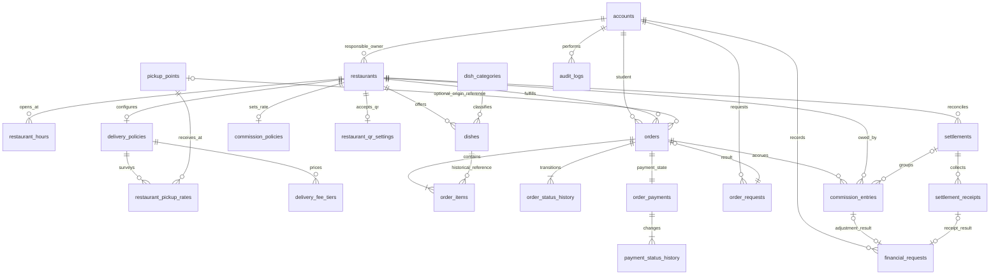

# Database Design — Hoa Lac Food Ordering Platform

## 1. Authority, scope and implementation boundary

- Business authority: [requirements.md](../requirements.md), especially §§6–7 and §9; architecture authority: [architecture.md](../architecture.md), especially §§3–7, §9 and §12.
- Target: **MySQL/InnoDB + Prisma + NestJS**, one database in a modular monolith. The account/audit slice and its first SQL migration now exist; remaining business tables are proposed and absent.
- Requirements determine behavior; this document chooses storage layouts, keys and numeric precision to implement that behavior. It does not add payment gateways, driver accounts, automatic collection or cross-restaurant orders.
- **DB** means an actual PK, FK, UNIQUE, CHECK or atomic transaction guarantee. **BE** means a NestJS domain/workflow/repository rule; a TypeScript type or Prisma annotation alone is not a database constraint.
- Tables use `snake_case`; Prisma models may use PascalCase with mapping attributes. Use real foreign keys, not application-only relation emulation. Keep the package versions/configuration from the project lockfile, including `prisma7.config.ts`; the MariaDB-named adapter does not change the MySQL target.
- Target **Oracle MySQL Community Server 8.4 LTS, release 8.4.11**, with InnoDB. Production/staging/local DB tests must use this release; changing patch or series requires reviewed compatibility and migration/race tests. MySQL 8.0.16 is only the historical CHECK-enforcement floor. Verify `SELECT VERSION()` and actual CHECK rejection before applying business migrations; fail on MariaDB or a different release. [MySQL 8.4 CHECK documentation](https://dev.mysql.com/doc/refman/8.4/en/create-table-check-constraints.html) describes enforcement.

## 2. Data groups and ownership

| Group / owning module | Tables | Delivery scope |
| --- | --- | --- |
| Accounts / `accounts` | `accounts` | MVP: contact data, password hash, role, account availability |
| Restaurants / `restaurants` | `restaurants`, `restaurant_hours` | MVP: one responsible owner per restaurant, multiple restaurants per owner |
| Menu / `dishes` | `dish_categories`, `dishes` | MVP: current catalog; visibility and availability are independent |
| Delivery / `delivery` | `pickup_points`, `delivery_policies`, `restaurant_pickup_rates`, `delivery_fee_tiers` | MVP surveyed points; fee tiers/free locations after MVP |
| Orders / `orders` | `orders`, `order_items`, `order_status_history`, `order_requests` | MVP, including durable history and snapshots |
| Payments / `payments` | `order_payments`, `payment_status_history`, `restaurant_qr_settings` | MVP cash; QR/refund extension after MVP |
| Commission / `commissions` | `commission_policies`, `commission_entries`, `settlements`, `settlement_receipts`, `financial_requests` | MVP manual reconciliation; later dashboards reuse these records |
| Audit / `audit` | `audit_logs` | MVP; transactional business audit |

The frontend owns the cart draft; no server cart table is required. Reorder builds a new intent and revalidates current conditions. AI conversations/training data are not stored. Support is Should; its order link is required but fields/workflow remain **TBD**. Reviews/favorites are Could and remain **TBD**, not implicit MVP tables. Image upload/media metadata is conditional; store only image references until that design is selected. MVP has no refresh-token/session table. `accounts.auth_version` invalidates issued JWTs on logout or operator credential/status changes; current account state is checked on every authenticated request.

## 3. ERD and cardinalities

The diagram shows intended committed aggregates: each order has at least one item, an initial history event, one payment and one successful order request. **BE** creates these together; FKs alone enforce only child-to-parent references, not mandatory children. A request result may temporarily be null inside its transaction, but must be populated before commit. Each financial request has exactly one result by commit. Actor FKs on history/finance tables are described below; audit targets deliberately have no FK.

## 4. Dictionary conventions

Every proposed column is listed below or supplied by an explicitly named common bundle. `N` = NOT NULL, `Y` = nullable; `—` = no default (caller must supply); `NULL` = SQL null default. `PK`, `FK`, `UQ` mean database constraints; grouped names share the stated type/null/default. No uniqueness is implied unless stated here or in §9.

| Common column / alias | MySQL / Prisma representation | Null | Default | Meaning / constraints |
| --- | --- | --- | --- | --- |
| `id` | BIGINT / BigInt | N | AUTO_INCREMENT | PK, positive surrogate ID; serialize as a decimal string over REST |
| `created_at` | DATETIME(3) / DateTime | N | CURRENT_TIMESTAMP(3) | Creation instant, stored as UTC |
| `updated_at` | DATETIME(3) / DateTime | N | CURRENT_TIMESTAMP(3) | BE updates on every mutation; Prisma `@updatedAt` is not a SQL trigger |
| `version` | INT UNSIGNED / Int | N | 1 | BE increments for conditional writes; cap at signed Prisma Int limit before overflow |
| `ID` | BIGINT / BigInt | As listed | As listed | Same signed type as referenced PK |
| `MONEY` | BIGINT / BigInt | As listed | As listed | Integer VND, exact; signed storage allows negative adjustments |
| `RATE` | DECIMAL(12,8) / Decimal | As listed | As listed | Fraction, not percentage: `0.10000000` means 10% |
| `LAT`, `LNG` | DECIMAL(9,6), DECIMAL(10,6) / Decimal | As listed | As listed | Coordinates; CHECK latitude −90..90, longitude −180..180 |
| `HASH`, `KEY` | CHAR(64), VARCHAR(128) / String | As listed | As listed | SHA-256 hex fingerprint; opaque idempotency key; ASCII binary collation |

Use `utf8mb4` for user text, `utf8mb4_0900_ai_ci` for catalog text, `utf8mb4_bin` for canonical usernames and keys, strict SQL mode, UTC database sessions and explicit FK actions. Use binary equality for keys/hashes and login identifiers after BE normalization. Scheduling and monthly reporting use `Asia/Ho_Chi_Minh`, converting boundaries to UTC. All IDs referenced below are indexed by a PK/UQ/index or an FK-supporting index. No secrets or raw payment credentials belong in JSON.

### 4.1. Accounts, restaurants and menu

`accounts` — common: `id`, `created_at`, `updated_at`, `version`.

| Column | Type | Null | Default | Meaning / keys |
| --- | --- | --- | --- | --- |
| `login_identifier` | VARCHAR(191) | N | — | Canonical lowercase ASCII username, UQ under binary collation; API §2 regex and length |
| `password_hash` | VARCHAR(255) | N | — | Argon2id PHC hash; API §2 parameters, never plaintext |
| `role` | ENUM(student, restaurant_owner, admin) | N | — | Canonical role mapping; public registration assigns student in BE |
| `display_name` | VARCHAR(200) | N | — | Account/contact name |
| `phone` | VARCHAR(32) | Y | NULL | Current contact phone; recipient phone required at checkout; not implicitly unique |
| `is_active` | BOOLEAN | N | TRUE | Account availability; not a new business lifecycle enum |
| `auth_version` | INT UNSIGNED | N | 1 | JWT version; increment on logout, credential reset, role/status change; reject overflow |

`restaurants` — common: `id`, `created_at`, `updated_at`, `version`.

| Column | Type | Null | Default | Meaning / keys |
| --- | --- | --- | --- | --- |
| `owner_id` | ID | N | — | FK → accounts.id; deliberately **not unique** |
| `name` | VARCHAR(200) | N | — | Current restaurant name |
| `address` | VARCHAR(1000) | N | — | Current restaurant address |
| `latitude`, `longitude` | LAT, LNG | Y | NULL | Both null or both populated; coordinates required by BE for route-based delivery |
| `contact_phone` | VARCHAR(32) | N | — | Restaurant contact |
| `is_active` | BOOLEAN | N | TRUE | Partner activation; FALSE blocks new orders |
| `is_accepting_orders` | BOOLEAN | N | FALSE | Operational switch; TRUE alone does not mean open/orderable |

`restaurant_hours` — common: `id`; no implicit timestamps.

| Column | Type | Null | Default | Meaning / keys |
| --- | --- | --- | --- | --- |
| `restaurant_id` | ID | N | — | FK → restaurants.id |
| `weekday` | TINYINT UNSIGNED | N | — | Local weekday, 1=Monday through 7=Sunday; CHECK 1..7 |
| `opens_at`, `closes_at` | TIME(0) / DateTime | N | — | Local clock times; BE validates 00:00–23:59:59 |
| `closes_next_day` | BOOLEAN | N | FALSE | Explicit overnight interval; BE rejects zero/overlapping intervals |

Hours are a proposed structured representation of required opening hours. Multiple intervals per day are supported; no interval means closed. Holiday exceptions and special-hours features are not introduced. Route quote validation uses the current operating interval at order creation.

`dish_categories` — common: `id`; `dishes` — common: `id`, `created_at`, `updated_at`, `version`.

| Table.column | Type | Null | Default | Meaning / keys |
| --- | --- | --- | --- | --- |
| dish_categories.name | VARCHAR(100) | N | — | Category label; UQ under selected collation; taxonomy/management permissions **TBD** |
| dishes.restaurant_id | ID | N | — | FK → restaurants.id; UQ `(id, restaurant_id)` supports composite item FK |
| dishes.category_id | ID | N | — | FK → dish_categories.id |
| dishes.name | VARCHAR(200) | N | — | Current dish name; no uniqueness restriction |
| dishes.description | TEXT | N | — | Description, empty string permitted |
| dishes.price_vnd | MONEY | N | — | Current price; CHECK ≥ 0 |
| dishes.image_reference | VARCHAR(2048) | Y | NULL | URL/storage reference, not image bytes; provider **TBD** |
| dishes.is_visible | BOOLEAN | N | TRUE | FALSE means hidden |
| dishes.is_available | BOOLEAN | N | TRUE | FALSE means sold out/stopped selling; independent of visibility |

### 4.2. Pickup points and delivery configuration

`pickup_points` — common: `id`, `created_at`, `updated_at`, `version`.

| Column | Type | Null | Default | Meaning / keys |
| --- | --- | --- | --- | --- |
| `name` | VARCHAR(200) | N | — | Fixed point label |
| `latitude`, `longitude` | LAT, LNG | N | — | Surveyed destination coordinates |
| `is_active` | BOOLEAN | N | TRUE | BE blocks new selection when disabled; old orders retained |

`delivery_policies` — common: `created_at`, `updated_at`, `version`; no `id`. `restaurant_pickup_rates` — common: `created_at`, `updated_at`, `version`; no `id`. `delivery_fee_tiers` — common: `id` only.

| Table.column | Type | Null | Default | Meaning / keys |
| --- | --- | --- | --- | --- |
| delivery_policies.restaurant_id | ID | N | — | PK, FK → restaurants.id; one policy at most per restaurant |
| delivery_policies.max_route_distance_m | INT UNSIGNED | Y | NULL | Post-MVP route limit; required by BE before enabling route-based quotes |
| restaurant_pickup_rates.restaurant_id | ID | N | — | Composite PK with pickup_point_id; FK → delivery_policies.restaurant_id |
| restaurant_pickup_rates.pickup_point_id | ID | N | — | Composite PK with restaurant_id; FK → pickup_points.id |
| restaurant_pickup_rates.distance_m | INT UNSIGNED | N | — | Surveyed distance in whole metres |
| restaurant_pickup_rates.delivery_fee_vnd | MONEY | N | — | Surveyed fee, CHECK ≥ 0; never inferred from missing data |
| restaurant_pickup_rates.is_enabled | BOOLEAN | N | TRUE | Current service availability for this pair |
| delivery_fee_tiers.restaurant_id | ID | N | — | FK → delivery_policies.restaurant_id |
| delivery_fee_tiers.min_distance_m | INT UNSIGNED | N | — | Inclusive lower boundary |
| delivery_fee_tiers.max_distance_m | INT UNSIGNED | N | — | Upper boundary; exclusive except last tier; CHECK max > min |
| delivery_fee_tiers.delivery_fee_vnd | MONEY | N | — | Fee, CHECK ≥ 0 |

MVP requires an enabled surveyed restaurant/point pair; missing pair means no confirmable quote. After MVP, BE checks route range, tier non-overlap and `[min,max)` boundaries, with the final maximum included (BR07–BR10). Missing coverage fails closed. All delivery edits bump policy version under the restaurant lock; pickup-point edits lock affected restaurants in ascending ID order before the point and bump point version.

A delivery quote is not a payment transaction. Proposed storage uses a server-authenticated quote artifact, verified by BE, then an immutable order snapshot; no quote table or provider cache is required. It binds restaurant, destination/point version, policy/survey version, distance, fee and issuance/expiry. After MVP, route quotes must expire; TTL, map provider and normalization of provider distance to whole metres are **TBD**, to be settled before enabling route ordering. External route calls occur before DB transactions.

### 4.3. Orders, items, history and durable idempotency

`orders` — common: `id`, `created_at`, `updated_at`, `version`.

| Column | Type | Null | Default | Meaning / keys |
| --- | --- | --- | --- | --- |
| `student_id` | ID | N | — | FK → accounts.id; role/ownership checked by BE |
| `restaurant_id` | ID | N | — | FK → restaurants.id; UQ `(id, restaurant_id)` for child consistency |
| `status` | ENUM(pending, accepted, rejected, cancelled, delivering, completed) | N | pending | Current order lifecycle, independent of payment |
| `pickup_point_id` | ID | Y | NULL | FK → pickup_points.id; required by BE for MVP, null for free location |
| `pickup_point_name_snapshot` | VARCHAR(200) | Y | NULL | Required by BE when a fixed point is selected |
| `recipient_name_snapshot` | VARCHAR(200) | N | — | Recipient at checkout |
| `recipient_phone_snapshot` | VARCHAR(32) | N | — | Recipient contact at checkout |
| `destination_text_snapshot` | VARCHAR(1000) | N | — | Fixed point label or supplied/resolved address/pin description |
| `destination_latitude_snapshot`, `destination_longitude_snapshot` | LAT, LNG | N | — | Confirmed destination coordinates |
| `distance_m_snapshot` | INT UNSIGNED | N | — | Verified surveyed/route distance, never straight-line substitution |
| `delivery_quote_snapshot` | JSON | N | — | BE-validated quote explanation, schema below |
| `subtotal_vnd` | MONEY | N | — | Sum of dish line amounts; CHECK ≥ 0 |
| `delivery_fee_vnd` | MONEY | N | — | Agreed fee snapshot; CHECK ≥ 0 |
| `total_vnd` | MONEY | N | — | CHECK ≥ 0 and total = subtotal + delivery_fee |
| `commission_rate_snapshot` | RATE | N | — | Agreed-at-creation commission fraction; CHECK ≥ 0 |
| `completed_at` | DATETIME(3) | Y | NULL | Set on completed; CHECK present iff status = completed |

`delivery_quote_snapshot` keys: `schema_version`, `source` (`survey` or `route`, technical provenance), `restaurant_id`, `policy_version`, `pickup_point_version` and `survey_version` (nullable for route), `destination` (text/coordinates and optional pickup point ID/name), `distance_m`, `delivery_fee_vnd`, `issued_at`, `expires_at` (nullable for MVP survey), and `matched_tier` (null for survey; otherwise min/max/fee and whether upper bound is inclusive). Serialize IDs/money as strings. BE checks consistency with typed columns; DB checks JSON syntax only. Do not save entire provider responses or credentials.

`order_items` — common: `id` only. `order_status_history` — common: `id`, `created_at` only, append-only.

| Table.column | Type | Null | Default | Meaning / keys |
| --- | --- | --- | --- | --- |
| order_items.order_id | ID | N | — | FK with restaurant_id → orders(id, restaurant_id) |
| order_items.restaurant_id | ID | N | — | Consistency discriminator for both composite FKs |
| order_items.dish_id | ID | N | — | FK with restaurant_id → dishes(id, restaurant_id) |
| order_items.dish_name_snapshot | VARCHAR(200) | N | — | Exact dish name accepted at checkout |
| order_items.unit_price_vnd | MONEY | N | — | Accepted price, CHECK ≥ 0 |
| order_items.quantity | INT UNSIGNED | N | — | CHECK > 0; BE also applies overflow/input bounds |
| order_items.line_total_vnd | MONEY | N | — | CHECK ≥ 0 and line_total = unit_price × quantity |
| order_status_history.order_id | ID | N | — | FK → orders.id; UQ `(order_id, order_version)` |
| order_status_history.order_version | INT UNSIGNED | N | — | Resulting order version; initial event uses 1 |
| order_status_history.from_status | Order status ENUM | Y | NULL | Null only for initial event, enforced by BE |
| order_status_history.to_status | Order status ENUM | N | — | Resulting status; initial pending |
| order_status_history.actor_id | ID | N | — | FK → accounts.id; actual authenticated actor |
| order_status_history.reason | VARCHAR(1000) | Y | NULL | CHECK trimmed nonempty when to_status = rejected |

`order_requests` — common: `id`, `created_at` only; result is immutable after success.

| Column | Type | Null | Default | Meaning / keys |
| --- | --- | --- | --- | --- |
| `actor_id` | ID | N | — | FK → accounts.id; part of UQ `(actor_id, operation, idempotency_key)` |
| `operation` | VARCHAR(32) | N | — | CHECK = `create_order`; technical operation label |
| `idempotency_key` | KEY | N | — | Client key, reused through retry/reload |
| `request_hash` | HASH | N | — | Digest of normalized intent, including agreed prices/quote; never a raw request body |
| `order_id` | ID | Y | NULL | UQ, FK → orders.id; populated before commit by BE |

Hash input includes restaurant ID, normalized/sorted dish IDs and quantities, accepted unit prices, destination/point, recipient fields, payment method and the accepted quote artifact/version. Normalize deterministically before hashing; preserve semantically different content. Client-agreed prices express consent only: BE compares them to authoritative prices and computes totals itself. A successful retry returns its existing order even after prices or the quote's validity have changed.

### 4.4. Payment state and history

Payment state lives in **`order_payments`**, not in `orders` and not in a platform payment-gateway ledger. The payments module alone writes it. `order_id` is both PK and FK, so DB allows at most one payment row; order creation ensures exactly one. History records every effective transition, initial unpaid, actor and evidence reference atomically. It is separate from commission collection receipts.

`order_payments` — common: `created_at`, `updated_at`, `version`; no `id`. `payment_status_history` — common: `id`, `created_at` only. `restaurant_qr_settings` — common: `created_at`, `updated_at`, `version`; no `id`, post-MVP.

| Table.column | Type | Null | Default | Meaning / keys |
| --- | --- | --- | --- | --- |
| order_payments.order_id | ID | N | — | PK, FK → orders.id |
| order_payments.method | ENUM(cash, qr) | N | — | Direct restaurant payment; BE enables cash only in MVP |
| order_payments.status | ENUM(unpaid, paid, refund_pending, refunded) | N | unpaid | Independent payment lifecycle |
| order_payments.confirmed_by | ID | Y | NULL | FK → accounts.id; actual restaurant confirmer |
| order_payments.confirmed_at | DATETIME(3) | Y | NULL | Receipt confirmation instant |
| order_payments.refunded_by | ID | Y | NULL | FK → accounts.id; restaurant actor recording refund |
| order_payments.refunded_at | DATETIME(3) | Y | NULL | Recorded refund completion instant |
| payment_status_history.order_id | ID | N | — | FK → order_payments.order_id; UQ `(order_id, payment_version)` |
| payment_status_history.payment_version | INT UNSIGNED | N | — | Resulting payment version; initial event uses 1 |
| payment_status_history.from_status | Payment status ENUM | Y | NULL | Null only at creation, checked by BE |
| payment_status_history.to_status | Payment status ENUM | N | — | Resulting payment status |
| payment_status_history.actor_id | ID | N | — | FK → accounts.id; includes student for initial unpaid event |
| payment_status_history.reason | VARCHAR(1000) | Y | NULL | Explanation, including cancelled/rejected order or late receipt |
| payment_status_history.evidence_reference | VARCHAR(2048) | Y | NULL | Optional protected reference, not proof supplied solely by a student |
| restaurant_qr_settings.restaurant_id | ID | N | — | PK, FK → restaurants.id |
| restaurant_qr_settings.qr_reference | VARCHAR(2048) | N | — | Restaurant-provided QR reference; representation/validation **TBD** before QR rollout |

DB CHECKs pair each confirmer/refunder ID with its timestamp; require confirmation fields for paid/refund_pending/refunded and refund fields iff refunded. BE validates legal changes and verifies the actor's current ownership. Cash receipt confirmation changes unpaid → paid. No payment state is a prerequisite for completed; marking paid never completes an order or creates platform commission receipts.

For the architectural QR extension: cancellation/rejection of an already-paid transfer changes paid → refund_pending in the same transaction; late confirmation on a cancelled/rejected order changes unpaid → refund_pending while recording confirmation fields/evidence. Restaurant-recorded completion changes refund_pending → refunded. Repeated effective confirmation/refund is a no-op after authorization. QR evidence requirements, other permitted refund transitions and exceptional cash refunds are **TBD**; do not silently enable extra transitions or automatic refunds.

### 4.5. Commission, settlements and manual receipts

`commission_policies` — common: `created_at`, `updated_at`, `version`; no `id`. `settlements` — common: `id`, `created_at` only.

| Table.column | Type | Null | Default | Meaning / keys |
| --- | --- | --- | --- | --- |
| commission_policies.restaurant_id | ID | N | — | PK, FK → restaurants.id; missing rate prevents ordering |
| commission_policies.rate | RATE | N | — | Current fraction; CHECK ≥ 0; admin changes affect future orders only |
| settlements.restaurant_id | ID | N | — | FK → restaurants.id; UQ `(id, restaurant_id)` for composite entry FK |
| settlements.period_start_at | DATETIME(3) | N | — | Inclusive UTC reconciliation boundary |
| settlements.period_end_at | DATETIME(3) | N | — | Exclusive UTC boundary; CHECK end > start |
| settlements.created_by | ID | N | — | FK → accounts.id; BE requires admin |

`commission_entries` — common: `id`, `created_at` only; append-only financial facts, except the one-time settlement assignment.

| Column | Type | Null | Default | Meaning / keys |
| --- | --- | --- | --- | --- |
| `restaurant_id` | ID | N | — | FK → restaurants.id; paired in order/settlement composite FKs |
| `order_id` | ID | N | — | FK `(order_id, restaurant_id)` → orders(id, restaurant_id) |
| `kind` | ENUM(base, adjustment) | N | — | Canonical commission entry types |
| `base_order_id` | ID | Y | NULL | UQ, FK → orders.id; CHECK equals order_id for base, NULL for adjustment |
| `amount_vnd` | MONEY | N | — | Base ≥ 0; adjustment signed; CHECK nonnegative for base |
| `reason` | VARCHAR(1000) | Y | NULL | CHECK trimmed nonempty for adjustment |
| `actor_id` | ID | N | — | FK → accounts.id; completing owner for base, recording admin for adjustment |
| `settlement_id` | ID | Y | NULL | FK `(settlement_id, restaurant_id)` → settlements(id, restaurant_id) |

The base guard CHECK must be `(kind='base' AND base_order_id IS NOT NULL AND base_order_id=order_id) OR (kind='adjustment' AND base_order_id IS NULL)`. Explicit null tests avoid SQL CHECK's UNKNOWN loophole. MySQL UNIQUE permits multiple NULLs, so unlimited adjustments coexist with at most one base per order without a partial index or generated column.

`settlement_receipts` — common: `id`, `created_at` only; append-only. `financial_requests` — common: `id`, `created_at` only.

| Table.column | Type | Null | Default | Meaning / keys |
| --- | --- | --- | --- | --- |
| settlement_receipts.settlement_id | ID | N | — | FK → settlements.id; restaurant obtained through settlement |
| settlement_receipts.amount_vnd | MONEY | N | — | Manual collection amount; CHECK > 0 |
| settlement_receipts.received_at | DATETIME(3) | N | — | Actual receipt instant supplied/validated by BE |
| settlement_receipts.recorded_by | ID | N | — | FK → accounts.id; BE requires admin |
| settlement_receipts.reference | VARCHAR(255) | Y | NULL | Optional manual collection reference; not globally unique |
| settlement_receipts.note | VARCHAR(1000) | Y | NULL | Optional reconciliation explanation |
| financial_requests.actor_id | ID | N | — | FK → accounts.id; part of UQ `(actor_id, operation, idempotency_key)` |
| financial_requests.operation | ENUM(record_receipt, create_adjustment) | N | — | Technical idempotency operations, not business statuses |
| financial_requests.idempotency_key | KEY | N | — | Stable key for each administrative intent |
| financial_requests.request_hash | HASH | N | — | Normalized payload hash; altered-content retry conflicts |
| financial_requests.receipt_id | ID | Y | NULL | UQ, FK → settlement_receipts.id; result of record_receipt |
| financial_requests.entry_id | ID | Y | NULL | UQ, FK → commission_entries.id; result of create_adjustment |

DB CHECK prevents both results being set and mismatched operation/result types; both may be null only while the transaction is in progress. BE requires the correct result before commit and verifies an entry result has kind adjustment. Successful request records are retained with their financial history. No settlement status, automatic close job, collected flag or cached totals are invented.

### 4.6. Audit

`audit_logs` — common: `id`, `created_at` only, append-only.

| Column | Type | Null | Default | Meaning / keys |
| --- | --- | --- | --- | --- |
| `actor_id` | ID | N | — | FK → accounts.id; authenticated initiating actor |
| `action` | VARCHAR(64) | N | — | BE-controlled action, e.g. dish.updated, payment.confirmed, commission.adjusted |
| `target_type` | VARCHAR(64) | N | — | BE-controlled resource/table identifier |
| `target_id` | ID | N | — | Logical object ID; intentionally no FK, survives target deletion |
| `changes` | JSON | N | — | Allowlisted before/after changed fields, reason and relevant IDs; scrub sensitive values |
| `request_id` | VARCHAR(128) | Y | NULL | Correlation identifier, not an idempotency constraint |

Audit dish/restaurant edits and deletes, policy/rate/owner changes, order transitions, payment confirmations/refunds, settlement assignment, adjustments and receipts. Audit is in the same transaction as the mutation; failure rolls back both. Do not log password hashes, tokens, raw requests, QR secrets or full recipient details. Runtime error/latency logs are separate and must not decide transaction success.

## 5. Enums and permitted state changes

Canonical role labels are Student, Restaurant Owner and Admin; persisted values are `student`, `restaurant_owner`, `admin`. Canonical methods “cash” and “QR transfer” map to `cash`, `qr`. SQL ENUM restricts values only; it cannot enforce actor permissions or transition paths.

- Order: initial `pending`; `pending → accepted | rejected | cancelled`; `accepted → delivering`; `delivering → completed`. Rejected/cancelled/completed are terminal. Student cancellation is limited to their own pending order; the owner handles acceptance/rejection/delivery/completion and supplies a rejection reason.
- Payment: `unpaid`, `paid`, `refund_pending`, `refunded`, governed separately as in §4.4. Scanning QR or reporting a transfer is never confirmation.
- Base/adjustment are entry kinds, not payment statuses. Available/sold-out/hidden menu display derives from booleans; no invented order statuses such as preparing, shipping or failed.
- **BE:** authorize first; requesting the current status is a no-op with no extra history/audit/commission. Requesting an older status after progress is a conflict. Admin has no implicit owner permission to transition orders or confirm payments.

## 6. Snapshot and exact arithmetic contract

Immutable after creation: order restaurant/student links; recipient name/phone; destination text/coordinates; optional fixed point ID/name; verified distance and quote explanation; delivery fee; subtotal/total; commission fraction; every item's dish reference, name, unit price, quantity and line total. Payment method is the checkout choice; changes to it are not an implemented feature. Current payment state, order state and their timestamps evolve only through their services.

Old orders display these fields, never current dish prices/names, pickup-point labels, account contact details or delivery/rate settings. Live joins are for authorization/navigation, not reconstructing historical prices. Restaurant name/address are not required order snapshots by the sources; if displayed from the live profile, do not label them historical. A later historical restaurant-label requirement needs an explicit schema change.

Money is integer VND throughout. Use BigInt/Prisma Decimal or exact decimal arithmetic, never JS floating-point multiplication for money/rates. RATE has eight fractional digits; reject extra precision instead of silently rounding the configured rate. Its technical maximum is `9999.99999999`; the permitted business maximum is **TBD** (do not infer an agreed 100% cap). Validate overflow before writes against signed BIGINT limits and Prisma integer limits for quantities/metres/versions; reject unsupported values.

Let `S = subtotal_vnd ≥ 0`, `R = rate × 100000000` as an exact integer. Base commission is `(S × R + 50000000) div 100000000`, using arbitrary-precision integers and integer division. This implements half-up once per order; never round each line's commission. Examples: 105 VND × 10% = 10.5 → 11 VND; 104 × 10% = 10.4 → 10 VND. Delivery fee is excluded. Adjustments are already integer VND and may be negative; no separate percentage rounding is implied.

`subtotal = Σ line_total`; `total = subtotal + delivery_fee`. DB checks per-row equations; **BE** computes the cross-row sum and commission from locked snapshots. Commission arises on completed even if payment is unpaid; rejected/cancelled orders have no base. `receivable = Σ(base + adjustments)`, `collected = Σ(receipts)`, `outstanding = receivable − collected`. Aggregate entries and receipts separately before joining settlements to avoid multiplying amounts. Do not clamp negative balances or invent paid-off statuses. Overcollection limits, receipt correction/reversal procedure, settlement overlap/closure and treatment of late adjustments are **TBD**; do not overwrite history to resolve them.

## 7. Integrity: explicit enforcement allocation

| Invariant | DB enforcement | BE enforcement |
| --- | --- | --- |
| One responsible owner; owner can manage many restaurants | Non-null owner FK, no owner UQ | Assigned account has restaurant_owner role; current ownership/active actor checked on locked writes; role changes cannot strand owned restaurants |
| One restaurant per order; all lines match | Non-null order FK; composite item→order and item→dish FKs | Nonempty cart, visible/available dishes, active/open/accepting restaurant; historical dish/order restaurant IDs immutable |
| Valid totals, rates and quantities | NOT NULL, CHECK domain/row equations; BOOLEAN checks restrict 0/1 | Cross-row subtotal, overflow, exact rounding and agreed-price/fee conflict handling |
| Durable order retries | Request scope UQ, result UQ/FK; atomic commit | Canonical hash, actor/result consistency, complete aggregate and result before commit |
| One base per order; no commission for cancelled/rejected orders | Base guard CHECK + nullable UQ(base_order_id) | Completed-only base creation, correct snapshot formula, completion and base in one transaction; adjustments require an existing base on a completed order |
| Entry in at most one settlement; same restaurant | Single nullable settlement_id and composite FK | Lock and assign only where settlement_id IS NULL; reject reassignment/unassignment |
| Valid status transition and exactly one event | ENUM domain; history UQ; atomic conditional update | State machine, permissions, meaningful reason, append event only after successful change |
| Payment independent; exact one row per order | PK/FK allows at most one; status/metadata CHECKs | Creation ensures one; owner verification, refund coordination, no duplicate effect |
| Non-overlapping delivery fees | Per-row min < max, nonnegative fee | Validate whole tier set/range and final inclusive maximum under lock |
| Historical immutability and complete audit | FKs block deletion; transaction makes mutation/audit atomic | Reject snapshot/ledger/history edits; only one-time settlement link update; audit redaction |

Define every CHECK in a reviewed SQL migration when Prisma cannot express it. Test SQL-level invalid inserts, not only service validation. For nullable conditions use explicit IS NULL/IS NOT NULL to avoid UNKNOWN passing a CHECK. No triggers or stored procedures are assumed. Runtime DB grants should deny UPDATE/DELETE on append-only histories, audit and receipts; commission entries need narrowly scoped settlement-link updates. Privileged migration/maintenance access remains separately controlled.

## 8. Deletion, retention and FK actions

**All FKs in this design use ON DELETE RESTRICT and ON UPDATE RESTRICT**, including history, request-result, actor and composite FKs. IDs are immutable. No cascade deletes of orders, payments, ledger entries, receipts or audit; no SET NULL that silently detaches history. Audit target_id is a logical reference, so deleting an unused target preserves its audit.

- Dish: physically delete only when never ordered; item FKs block deletion otherwise. Hide/stop selling an ordered dish. Deleting a category with dishes is blocked; category lifecycle is not expanded here.
- Restaurant: admin physically deletes only with no orders and no settlements. Under the shared restaurant lock, owner services explicitly delete unused menu, hours, delivery tiers/survey links/policy, QR configuration and commission policy, then restaurant; write audit in the same transaction. Retain owner account and their other restaurants. Historical FKs are a final safeguard if a check races.
- Restaurant with history: deactivate; keep handling existing orders and outstanding commission. This does not cancel orders or erase management links.
- Pickup points: disable when referenced; RESTRICT protects orders. Unused points may be removed after configuration links are deliberately cleaned. Preserve snapshots regardless of later edits.
- Accounts: deactivate to preserve ownership/actor history. Physical account deletion, personal-data retention/anonymization periods and privileged purge procedure are **TBD**; do not implement automatic purges. Retain successful idempotency keys for the order/financial history lifetime, not a short TTL.
- Financial facts/history/audit are append-only at the application boundary. Correct commission with a new reasoned adjustment. Receipt corrections need the unresolved policy in §6; never edit/delete a receipt to hide the original. Optional image cleanup is after commit, reference-checked and retryable, outside MySQL atomicity.

## 9. Index plan

Create PK/UQ indexes from the dictionary plus the following named-column indexes; avoid duplicating indexes already covered by a leftmost prefix. FKs require supporting indexes. Add only measured search/report indexes beyond this baseline.

| Table | Index columns / uniqueness | Query or protection |
| --- | --- | --- |
| accounts | UQ login_identifier | Login lookup |
| restaurants | `(owner_id, id)`; `(is_active, name, id)` | Owner scope; active restaurant browsing |
| restaurant_hours | `(restaurant_id, weekday, opens_at)` | Opening intervals |
| dishes | `(restaurant_id, is_visible, is_available, category_id, price_vnd, id)`; `(name, id)` | Menus/category/price filters; prefix name search |
| restaurant_pickup_rates | PK `(restaurant_id, pickup_point_id)`; `(pickup_point_id, restaurant_id)` | Quote lookup and point-change locking |
| delivery_fee_tiers | UQ `(restaurant_id, min_distance_m)` | Ordered tier lookup; does not prove non-overlap |
| orders | `(student_id, created_at, id)`; `(restaurant_id, created_at, id)`; `(restaurant_id, status, created_at, id)`; `(restaurant_id, completed_at, id)` | Student history, owner lists/polling, completed-order revenue by period |
| order_items | `(order_id, restaurant_id)`; `(dish_id, restaurant_id)` | Aggregate loading; historical dish checks; composite FKs |
| order_status_history / payment_status_history | UQ `(order_id, order_version)` / `(order_id, payment_version)` | Ordered timeline and duplicate event defense |
| order_requests / financial_requests | UQ `(actor_id, operation, idempotency_key)` plus result UQs | Retry arbitration and durable result lookup |
| commission_entries | UQ base_order_id; `(order_id, restaurant_id)`; `(settlement_id, restaurant_id)`; `(restaurant_id, settlement_id, created_at, id)` | Base uniqueness; composite FKs; unassigned-period selection |
| settlements | `(restaurant_id, period_start_at, period_end_at, id)` | Restaurant reconciliation periods; intentionally nonunique |
| settlement_receipts | `(settlement_id, received_at, id)` | Collection sums and receipt timeline |
| audit_logs | `(target_type, target_id, created_at, id)`; `(actor_id, created_at, id)` | Object and actor traceability |

Substring searches such as `%term%` are not accelerated by ordinary name indexes; start with bounded queries and measure before selecting a search extension. Use stable keyset pagination with timestamp/ID tie-breakers. Define monthly boundaries in local business time; store/query half-open UTC intervals. Completed-order reports use completed_at; settlement totals use assigned entries. Period membership rules for late adjustments remain **TBD**, rather than silently substituting order creation time.

## 10. Transaction and concurrency recipes

Workflow opens one Prisma interactive transaction and passes the same TransactionContext to public services; each repository accesses only its module's tables. Use parameterized locking SQL in repositories where Prisma lacks a locking primitive. Read current data with locking reads, not earlier nonlocking snapshots; specify/test the isolation setting on real MySQL. No AI/map/storage calls or real-money transfers inside retried transactions.

Global lock order: relevant account rows ascending ID (actor and any account being assigned) → request-key row when applicable → restaurant(s) ascending ID → orders then dishes, each ascending ID → referenced pickup point and delivery policy/survey/tier rows in fixed table/ID order → commission policy → payment → settlements ascending ID → commission entries ascending ID. The account prefix serializes role/deactivation checks; the remaining order follows architecture §7.1. Lock only needed groups. Catalog, owner assignment, fees/rates, activation and deletion all participate in restaurant locking. Point changes discover affected restaurants, lock them ascending, lock the point, recheck the relationship set and retry if it changed; pair creation also follows restaurant→point locking.

1. **Create order:** authenticate and normalize payload; look up `(actor, create_order, key)`. For an existing successful key compare hash and return the original order, or conflict on changed content, before evaluating new prices. Otherwise insert/reserve the unique key inside the transaction; lock restaurant and relevant records, recheck actor, catalog, opening hours, destination, quote versions/expiry and commission rate. Reject stale agreed prices/fees. Compute and insert order/items, initial pending event, unpaid payment/event, audit and request result; commit together. On key collision roll back/re-read the winner, with bounded waiting; never commit a placeholder request alone.
2. **Transition:** lock restaurant then order, recheck current owner/student access. If current target is already reached, return authorized no-op. Otherwise validate edge and issue `UPDATE orders SET status=?, version=version+1 ... WHERE id=? AND status=? AND version=?`; require exactly one affected row. Append history/audit. For completed insert the unique base using snapshots; failure rolls back completed. For paid QR cancellation/rejection include refund_pending and payment history/audit in this transaction.
3. **Confirm payment/refund:** lock restaurant→order→payment, authorize current owner and inspect the latest order/payment states. Conditional update by status/version, confirmation/refund metadata, history and audit commit together. Handle late transfer confirmation on terminal orders as §4.4; never reopen the order. Repeated confirmation has no new receipt or commission effect.
4. **Create settlement:** lock restaurant, selected entries in ID order (and any existing settlement rows first). Verify same restaurant, eligible selection and no previous assignment. Insert settlement and set each entry with `WHERE id=? AND restaurant_id=? AND settlement_id IS NULL`; require the expected total affected rows or roll back all assignments and audit. A non-null settlement FK alone does not prevent later reassignment; the conditional repository operation does.
5. **Record receipt/adjustment:** after the account prefix, reserve a financial request key, then follow the shared locks, check admin permission and immutable financial context, insert fact plus audit and request result in one transaction. Adjustments require a completed order with its base entry and a nonempty reason. Same key/content returns prior result; changed content conflicts. No external collection is performed. Receipt and adjustment totals are derived on read, avoiding a second mutable balance source.
6. **Mutate/delete catalog or policies:** after the account prefix, acquire shared restaurant lock, validate current authority/history, update rows and relevant versions or explicitly clean unused children, and append audit before commit. Account role changes lock the affected account before its restaurants; forbid removing the owner role while responsible restaurants remain. Every write workflow follows the same account prefix, never locking an account after a restaurant.

Retry only transient deadlocks/lock timeouts, bounded (architecture proposes up to three attempts with backoff), replaying the entire transaction with the same request key. Conflicts, invalid transitions and permission errors are not automatic retries. Unique violations require inspecting which constraint failed, not generic success. Never rely on a Node.js mutex for cross-instance correctness. A committed response lost in transit is recovered through its durable request record.

## 11. Migration, seed and verification strategy

- Maintain `backend/prisma/schema.prisma` and reviewed `backend/prisma/migrations/`; use the existing configuration/lockfile. Migration artifacts include CHECKs, composite FKs, indexes and explicit referential actions; inspect generated SQL. Keep custom SQL represented/documented so later migrations do not remove constraints accidentally.
- Develop against disposable local MySQL, review migration diffs, apply to an empty database and an upgraded fixture, then inspect actual constraints. Pin the selected MySQL version and verify its CHECK/strict-mode behavior. Do not substitute SQLite or ORM mocks for financial/concurrency integration tests.
- For populated databases use expand→backfill→validate→constrain→contract: add compatible nullable/new structures, backfill in bounded batches from trustworthy data, verify invariants, then enforce required fields and retire old readers. Missing historical snapshots cannot be invented from current menu data; resolve and document migration policy first.
- Production uses reviewed deploy migrations with a separate migration identity and pre-deploy backup/restore plan. Never run reset, force-reset, destructive schema push or demo seeds on real data. Do not edit migrations already applied; make forward corrective migrations. Coordinate incompatible schema/app deployment and explicitly plan restoration for destructive changes.
- Seed only explicit local/test targets with a database-name/environment allowlist and a refusal for real deployments. Use deterministic fictional students, one owner with multiple restaurants, a second owner, admin, categories/dishes, fixed VJU pickup points and clearly labeled test survey fees/rates. Hash test passwords; no real contacts, QR accounts, provider keys or production credentials. Do not treat demo distances/fees as real surveys.
- Include fixtures for hidden/sold-out dishes, inactive/closed restaurants, all order/payment states appropriate to the test scope, zero/fractional-rate rounding, adjustments, unassigned/assigned entries and partial receipts. Construct consistent snapshots/history/ledger, preferably through the same services. Post-MVP QR fixtures belong to an explicitly enabled test scope.
- Required implementation tests: direct SQL constraint violations; accept/cancel race; concurrent same-key order creation and changed-hash conflict; price/fee/owner/deactivation races; repeated completed with one base; completion/audit rollback; payment/cancel and late-confirmation races; overlapping settlement assignment; financial retry deduplication; historical snapshots after edits; restricted deletion. Assert both results and durable row counts/history.
- Daily backups and a successfully verified restore are required before go-live (NFR08). Retention, hosting, AI/map/storage providers, quote TTL, support/review/favorite design and unresolved financial correction/period policies remain **TBD**; finalize only the relevant decisions before enabling those capabilities.

This document specifies guarantees to implement and verify; it does not claim that a schema migration, database integration test or production backup has already run.
