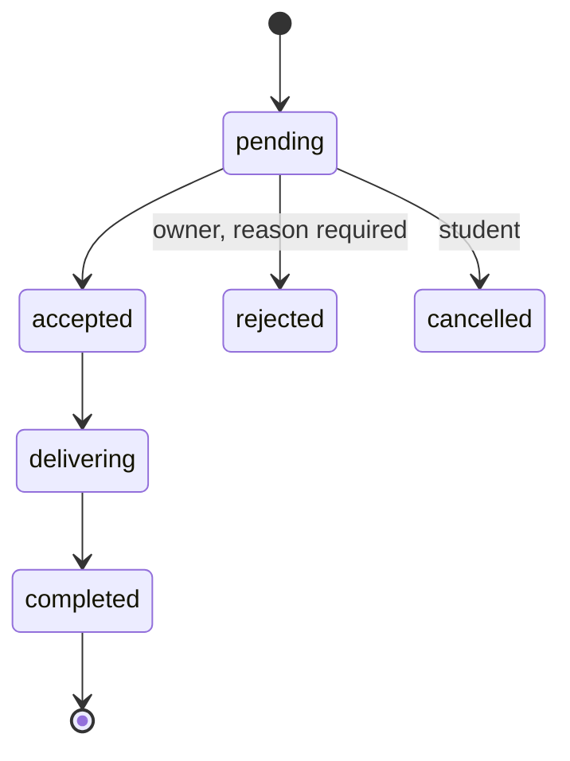

# Product Requirements — Hoa Lac Food Ordering Platform

> **Role of this document:** source of truth for *what the system must do*. Architecture, data, API, UI, AI, testing and deployment documents derive from it and MUST NOT contradict it.
> **Sources:** requirement analysis and system design documents (Vietnamese originals). Terminology here is the canonical English form.

## 1. Project Overview

| Item | Value |
| --- | --- |
| Name | Hoa Lac Food Ordering Platform |
| Goal | Help university students in Hoa Lac discover restaurants and dishes, get AI food recommendations, and order from partner restaurants. |
| Initial deployment (MVP) | Vietnam Japan University (VJU) |
| Future scope | Other universities in the Hoa Lac area |
| Type | Live, operational website (not a prototype) |
| Roles | Student, Restaurant Owner, Administrator |
| Frontend (decided) | Vite + React + TypeScript |
| Backend (decided) | NestJS + TypeScript |
| Database (decided) | MySQL (InnoDB) |
| ORM (decided) | Prisma |
| API (decided) | REST API |
| Auth (decided) | JWT |
| Styling (decided) | Tailwind CSS |
| Architecture (decided) | Modular monolith, logical 3-tier separation (presentation / business logic / data) |
| External services | AI/LLM service and map/location service — providers **TBD** |

The Vite + React frontend communicates with the NestJS backend through REST APIs. The backend uses Prisma to access MySQL and validates JWTs for authenticated requests. Role and ownership checks are enforced in the backend. Tailwind CSS is used for frontend styling.

### 1.1 Operating Model (summary)

- Restaurants **deliver orders themselves**. The platform has no driver accounts.
- Students pay **cash or QR directly to the restaurant**; the restaurant confirms receipt.
- The platform computes and tracks **commission** on completed orders; collection is **manual**.
- The platform determines route distance, delivery eligibility and delivery fee per each restaurant's policy.

## 2. Scope

### 2.1 Priority Legend

| Label | Meaning |
| --- | --- |
| **Must** | Required for the complete product |
| **Should** | Important, may be deferred |
| **Could** | Added only if resources allow |
| **Won't** | Out of current project scope |
| **MVP** | A separate delivery milestone; does **not** equal "all Must" |

MoSCoW applies to the whole project. MVP is only the first rollout.

### 2.2 In Scope (complete product)

- Account registration/login and role-based authorization.
- Restaurant and dish search, menu viewing.
- Delivery location (address or map pin), route distance, delivery eligibility and fee.
- Cart, order placement, order tracking, order cancellation (rule-limited).
- Cash and QR payment tracking (restaurant-confirmed).
- AI food recommendations; random dish selection.
- Dish CRUD (restaurant owner) and restaurant CRUD (admin).
- Commission calculation, tracking, settlement and reconciliation (manual collection).
- Order history and reorder, support tickets, audit logging.
- Reviews and favorites (Could).

### 2.3 Out of Scope

| Item | Reason |
| --- | --- |
| Delivery-driver accounts, auto dispatch, route optimization (US21) | Restaurants deliver themselves |
| Automatic payment splitting and automatic commission collection (US22) | Customers pay the restaurant directly; platform only computes, tracks, reconciles |
| Orders spanning multiple restaurants | One order belongs to one restaurant |
| Storing AI conversations or training data | Not in current scope |

### 2.4 MVP at VJU

- A few partner restaurants, **fixed pickup points**, surveyed delivery fees.
- Dish browsing, cart, ordering; restaurant accepts and updates status.
- Dish CRUD by owner; basic restaurant CRUD by admin (history-preserving rules apply).
- **Cash payment**, AI recommendations, manual commission reconciliation.

### 2.5 Complete Product (beyond MVP)

- All Must stories; expand to other universities in the service area.
- Free-form address / map pin, route distance, QR payment, commission dashboards for restaurants and admin.
- Then Should stories, prioritizing random selection, order history/reorder, support.

## 3. User Stories

| ID | Actor | Story (short) | Priority |
| --- | --- | --- | --- |
| US01 | Student | Register, log in, manage contact info to place and track own orders. | Must |
| US02 | Student | Search restaurants and dishes by name, category, price range. | Must |
| US03 | Student | View menu, price, opening hours, dish availability. | Must |
| US04 | Student | Enter address or pin a location; see distance, deliverability, delivery fee. | Must |
| US05 | Student | Add dishes of one restaurant to cart, edit quantities, see total before ordering. | Must |
| US06 | Student | Choose cash or restaurant QR transfer. | Must |
| US07 | Student | Track order status; cancel while restaurant has not accepted. | Must |
| US08 | Student | Get AI dish suggestions by budget, preferences, pickup/delivery point. | Must |
| US09 | Student | Pick a random dish that satisfies ordering conditions. | Should |
| US10 | Student | View order history and reorder. | Should |
| US11 | Restaurant Owner | Create, read, update, delete dishes in own restaurant's menu. | Must |
| US12 | Restaurant Owner | Update restaurant info, hours, order-accepting status, delivery range and fees. | Must |
| US13 | Restaurant Owner | Receive, accept or reject (with reason) orders and update progress. | Must |
| US14 | Restaurant Owner | Configure payment QR; confirm payment after verifying the transaction. | Must |
| US15 | Restaurant Owner | View completed orders, dish revenue and commission per period. | Must |
| US16 | Admin | Create, read, update, delete restaurants; manage responsible owner accounts. | Must |
| US17 | Admin | Set commission rate per restaurant; view monthly totals, receivable/collected amounts; reconcile. | Must |
| US18 | Student / Restaurant Owner | Submit a support request linked to an order. | Should |
| US19 | Student | Review a restaurant after a completed order. | Could |
| US20 | Student | Save favorite dishes or restaurants. | Could |
| US21 | Delivery person | Auto-assigned orders and optimized routes. | **Won't** |
| US22 | Admin | Automatic payment splitting and commission collection. | **Won't** |

## 4. Functional Requirements

| ID | Area | Requirement |
| --- | --- | --- |
| FR01 | Accounts and authorization | Students manage own account; owners manage own restaurant data; admin manages partners and operations. Roles: student, restaurant owner, admin. |
| FR02 | Search and menu | View, search, filter restaurants and dishes; show price, hours, availability. |
| FR03 | Location and delivery fee | Resolve pickup point/address, route distance, delivery range and fee per restaurant policy (produces a *delivery quote*). |
| FR04 | Cart and orders | Manage cart, compute totals, place, accept, track and cancel orders per status rules. |
| FR05 | Payment | Choose cash or QR; restaurant confirms receipt. |
| FR06 | Recommendations | AI suggestion and random selection from eligible dishes only. |
| FR07 | Dish CRUD | Owner creates, views, edits, deletes, or hides dishes of own restaurant. |
| FR08 | Restaurant CRUD | Admin creates, views, edits, deletes, or deactivates restaurants; owner edits only permitted operational data of own restaurant. |
| FR09 | Commission and settlement | Compute commission on completed orders; aggregate by restaurant, period, collected/uncollected. |
| FR10 | Utilities and support | History, reorder, order-linked support; reviews and favorites by priority. |

### 4.1 Role Permissions (summary)

| Capability | Student | Restaurant Owner | Admin |
| --- | --- | --- | --- |
| Browse restaurants/dishes | Yes | Yes | Yes |
| Place / cancel (pending) own orders | Yes | — | — |
| Manage dishes | — | Own restaurant only | — |
| Edit operational info (hours, status, delivery policy, QR) | — | Own restaurant only | — |
| Create / delete restaurant, assign owner | — | — | Yes |
| Update order status | — | Own restaurant's orders | — |
| Confirm payment / mark refunded | — | Own restaurant's orders | — |
| Set commission rate, record receipts, adjustments | — | — | Yes |
| View commissions / settlements | — | Own restaurant only | All |

Authorization is enforced **server-side**; the client's claimed `user_id` or `role` is never trusted.

## 5. Non-Functional Requirements

Thresholds are **proposed acceptance targets** and must be measured during implementation.

| ID | Attribute | Criterion |
| --- | --- | --- |
| NFR01 | Performance | ≥ 95% of restaurant/dish list loads finish within 2 s at 50 concurrent users, in a documented test environment. |
| NFR02 | AI latency | ≥ 95% of requests return within 5 s; after 10 s show a retry message; manual ordering remains available. |
| NFR03 | Security | HTTPS; hashed passwords; secret keys kept server-side; access and ownership checks on the server. |
| NFR04 | Correctness | Re-check price, dish and fee before order creation; commission matches rate and data stored on the order. |
| NFR05 | Reliability | Repeated identical requests create no duplicate order or commission; a confirmed order survives page reload. |
| NFR06 | Usability | View → select pickup point → order → track works at 360 px width without horizontal scroll. |
| NFR07 | Auditability | Record actor, time and content on changes to dishes/restaurants, payment confirmation, commission adjustments. |
| NFR08 | Recovery | Daily backups; a successful restore is verified before going live. |

## 6. Business Rules

### 6.1 Orders and Pricing

| ID | Rule |
| --- | --- |
| BR01 | One order belongs to exactly one restaurant; all items come from that restaurant. |
| BR02 | `total = subtotal (dish amounts) + delivery fee`. Money is integer VND. |
| BR03 | The server computes all amounts. If price or fee changed since the customer agreed, reject with a conflict and require re-confirmation. |
| BR04 | Dish names/prices, delivery fee, distance, recipient info and commission rate are **snapshotted on the order**; later edits to dishes, restaurants or policies never alter existing orders. |
| BR05 | Orders can only be placed for dishes that are visible and available, at a restaurant that is active, open and accepting orders. |
| BR06 | Order creation must be idempotent: the same request retried returns the original order; the same key with different content is a conflict. |

### 6.2 Delivery

| ID | Rule |
| --- | --- |
| BR07 | Distance is **route distance**; delivery range and fee tiers are configured per restaurant. |
| BR08 | If the distance, eligibility or fee cannot be determined (e.g. map service failure), the order cannot be confirmed; the system never estimates or invents a fee. |
| BR09 | Fee tiers must not overlap. Boundaries are `[min, max)`; the last tier includes its maximum distance. |
| BR10 | MVP uses fixed pickup points with pre-surveyed distance and fee per restaurant. |

### 6.3 Payment

| ID | Rule |
| --- | --- |
| BR11 | Payment methods: cash or QR transfer paid **directly to the restaurant**. |
| BR12 | Scanning a QR or the customer reporting a transfer is **not** proof of payment; the restaurant must verify and confirm. |
| BR13 | Payment status is tracked separately from order status: `unpaid`, `paid`, `refund_pending`, `refunded`. |
| BR14 | Refunds of transfers are made by the restaurant directly; the system records the result. |

### 6.4 Order Lifecycle and Cancellation

| ID | Rule |
| --- | --- |
| BR15 | A student can cancel only while the order is `pending`. |
| BR16 | After acceptance, the student cannot change status; they submit a support request. |
| BR17 | Owner rejection requires a reason. Invalid transitions are rejected. |
| BR18 | Resubmitting the current status causes no additional effect (no duplicate commission or transition event). |
| BR19 | A race between cancel and accept results in exactly one valid transition. |

### 6.5 Commission and Settlement

| ID | Rule |
| --- | --- |
| BR20 | Commission = dish subtotal of a **completed** order × commission rate snapshotted on the order. **Delivery fee is excluded.** |
| BR21 | Rounded to the nearest VND; a fraction of 0.5 or more rounds up. |
| BR22 | Cancelled or rejected orders generate no commission. |
| BR23 | Each order has at most one base commission entry. Adjustments are separate entries with a mandatory reason; history is never overwritten. |
| BR24 | Changing a restaurant's rate affects only future orders. |
| BR25 | A commission entry belongs to at most one settlement; all entries in a settlement belong to the same restaurant. |
| BR26 | Receivable = base + adjustments; collected = sum of recorded receipts; outstanding = receivable − collected. |
| BR27 | Collection is **manual**: admin records receipts. No automatic splitting or collection. |

### 6.6 Recommendation and Reorder

| ID | Rule |
| --- | --- |
| BR28 | AI and random selection only return real dishes that are available and deliverable to the chosen point. |
| BR29 | AI never decides prices, fees, or creates orders; output is validated against real data. |
| BR30 | No names, phone numbers or detailed addresses are sent to the AI service. |
| BR31 | If AI fails, show a suitable message; manual ordering still works. |
| BR32 | Reorder re-validates current price, availability and delivery fee. |

## 7. CRUD Rules and Ownership

### 7.1 Dishes (Restaurant Owner)

| Operation | Rule |
| --- | --- |
| Create | Name, description, price, optional image, category, availability status. |
| Read | Owner sees all dishes incl. available, sold-out, hidden. |
| Update | Name, price, image, availability. Existing orders keep their snapshot. |
| Delete | **Delete** only if the dish never appeared in any order. Otherwise **hide / stop selling**. |

### 7.2 Restaurants (Admin)

| Operation | Rule |
| --- | --- |
| Create | Name, address/location, contact, responsible owner account. |
| Read | List, details, active status. |
| Update | Partner info, responsible account, status. Owners edit only permitted operational data of own restaurant. |
| Delete | **Delete** only if there are no orders and no settlements. Otherwise **deactivate** and retain data. |

### 7.3 Constraints

- An owner cannot edit or delete another restaurant's dishes, nor create/delete restaurants.
- Hidden dishes and deactivated restaurants accept no new orders.
- Deactivation does not cancel in-progress orders or remove commission still to be reconciled.
- Deleting an unused restaurant also removes its menu and revokes the owner's management access.
- The UI requires confirmation before delete and clearly distinguishes **delete** from **hide/deactivate**; APIs state which happened.
- One owner may manage several restaurants; each restaurant has one responsible owner account.

## 8. Acceptance Criteria

| # | Scenario | Expected result |
| --- | --- | --- |
| AC1 | Owner adds a dish and changes its price. | Change is visible; editing another restaurant's dish is denied. |
| AC2 | Owner deletes a dish. | Never-ordered dish is deleted; ordered dish is only hidden; old orders keep name and price. |
| AC3 | Admin creates, edits and deactivates a restaurant. | Deactivated restaurant takes no new orders; old orders and settlement data remain. |
| AC4 | Valid order is placed. | Correct order and total created; sold-out dish, closed restaurant or out-of-range point creates no order. |
| AC5 | Student reports a QR transfer. | Payment becomes `paid` only after restaurant confirmation. |
| AC6 | Order completed. | Commission excludes delivery fee; later rate change does not alter old orders. |
| AC7 | AI or map service fails. | Clear message; no invented dish, distance or fee; manual ordering still possible. |
| AC8 | Cross-account access attempt. | Students and owners cannot access others' orders or financial data. |
| AC9 | Order request resent. | Original order returned; no duplicate. |
| AC10 | Completed status resent. | No extra commission created. |
| AC11 | Commission already in a settlement. | Cannot be placed into another settlement. |
| AC12 | Student cancels while pending vs. after acceptance. | Allowed when pending; after acceptance only via support request. |

## 9. Terminology

| Term | Definition |
| --- | --- |
| Student | End customer who browses and orders. |
| Restaurant Owner | Account responsible for one or more partner restaurants; manages menu, operations, orders. |
| Admin | Platform operator managing restaurants, commission policy and reconciliation. |
| Restaurant | Partner food business; delivers its own orders. |
| Dish | A menu item with a price, belonging to one restaurant. |
| Order | A student's purchase from one restaurant, with item snapshots and totals. |
| Order item | A dish line of an order with name/price snapshot and quantity. |
| Pickup point | Fixed delivery/pickup location used in MVP (name, coordinates) with per-restaurant distance and fee. |
| Delivery quote | Result of distance, deliverability and fee calculation for a restaurant and location. |
| Delivery fee rule | Distance range → fee mapping defined per restaurant. |
| Commission | Percentage of a completed order's dish subtotal owed to the platform. |
| Commission entry | Base or adjustment record of commission for an order. |
| Settlement | Reconciliation period for one restaurant grouping commission entries. |
| Settlement receipt | Record of a manual commission payment collected by admin. |
| Idempotency key | Client-supplied key preventing duplicate order creation. |
| Audit log | Record of who changed what and when. |

## 10. Assumptions and TBD

| Item | Status |
| --- | --- |
| Quán delivers itself; no driver accounts | Assumed, fixed |
| One owner may manage multiple restaurants; one responsible owner per restaurant | Assumed |
| One order = one restaurant | Assumed, fixed |
| AI/LLM provider | **TBD** |
| Map/location provider | **TBD** |
| Server hosting and infrastructure configuration | **TBD** |
| NFR thresholds | Proposed; confirm after measurement |
| Reviews and favorites detail design | Could; defined at implementation |

## 11. Traceability

| Downstream document | Derives from |
| --- | --- |
| `ARCHITECTURE/architecture.md` | Sections 1, 5 |
| `DATA/database.md` | Sections 6, 7, 9 |
| `API/api-contract.md` | Sections 3, 4, 6 |
| `UI/ui-flows.md` | Sections 3, 4.1, 8 |
| `AI/ai-integration.md` | BR28–BR31, US08, US09 |
| `TESTING/testing.md` | Sections 5, 8 |
