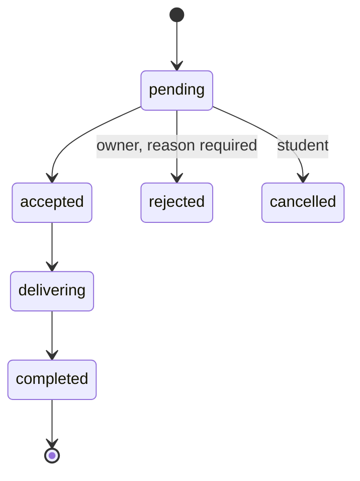

# Product Requirements — Hoa Lac Food Ordering Platform

> **Role of this document:** source of truth for *what the system must do*. Architecture, data, API, UI, AI, testing and deployment documents derive from it and MUST NOT contradict it.
> **Revision:** October 18, 2026 commercial V1.0 decision. Supersedes the former role-request, multi-restaurant-owner and cash-only launch design. See [roadmap](roadmap.md) for version gates and [implementation status](implementation-status.md) for source/evidence boundaries.

## 1. Project Overview

| Item | Value |
| --- | --- |
| Name | Hoa Lac Food Ordering Platform |
| Goal | Help university students in Hoa Lac discover restaurants and dishes, get AI food recommendations, and order from partner restaurants. |
| Initial deployment (MVP) | Vietnam Japan University (VJU) |
| Future scope | Other universities in the Hoa Lac area |
| Type | Live, operational website (not a prototype) |
| Identities and capabilities | Ordinary user (buyer); current restaurant manager by ownership; one operator-owned Admin |
| Frontend (decided) | Vite + React + TypeScript |
| Backend (decided) | NestJS + TypeScript |
| Database (decided) | Oracle MySQL Community Server 9.2.0 (InnoDB) |
| ORM (decided) | Prisma |
| API (decided) | REST API |
| Auth (decided) | JWT |
| Styling (decided) | Tailwind CSS |
| Architecture (decided) | Modular monolith, logical 3-tier separation (presentation / business logic / data) |
| External services | AI, email, media and hosting decisions in [decision register](decisions.md); maps deferred to V1.2 |

The Vite + React frontend communicates with the NestJS backend through REST APIs. The backend uses Prisma to access MySQL and validates JWTs for authenticated requests. Role and ownership checks are enforced in the backend. Tailwind CSS is used for frontend styling.

### 1.1 Operating Model (summary)

- Restaurants **deliver orders themselves**. The platform has no driver accounts.
- Students pay **cash or QR directly to the restaurant**; the restaurant confirms receipt.
- The platform computes and tracks **commission** on completed orders; collection is **manual**.
- V1.0 uses verified fixed VJU pickup points and surveyed restaurant–point fees. Route-based free addresses belong to V1.2.

## 2. Scope

### 2.1 Version scope and priority

[Roadmap](roadmap.md) owns versions, dependencies, acceptance gates and release conditions. “MVP” in retained older evidence means the former design, not commercial readiness. V0.x increments are implementation milestones; V1.0 is the first commercial VJU release. Must/Should/Could express priority within the assigned version, not permission to skip V1.0 gates.

### 2.2 V1.0 in scope

- Anonymous homepage, restaurant search/list and public menus; guests may build one-restaurant carts.
- Email-verified ordinary-user registration without role selection. A manager keeps buyer rights under the same identity.
- One restaurant maximum per account; opening application, versioned partnership consent and review history; approval creates restaurant and ownership atomically.
- One operator-owned Admin, MFA, recovery and protected provisioning; no website flow can request or grant additional Admin access.
- Restaurant setup, hours, dishes/images, fixed VJU points and surveyed fees; explicit commission configuration before selling.
- Cash orders, durable tracking/history/recovery; QR paid directly to the restaurant, owner-verified receipt and recorded direct-refund obligations.
- Manual commission ledger, reconciliation, receipts/reports; user/restaurant administration, order-linked support and audit lookup.
- Grounded AI recommendations with approved privacy/cost controls and manual fallback.
- Tested staging, real-partner pilot, backup/restore, incident/support procedures and approved controlled release.

### 2.3 Excluded

No driver accounts/dispatch (US21), automatic collection/splitting (US22), platform custody of customer funds, multi-restaurant orders, stored AI conversations/training, multiple restaurants per manager, or additional website-created Admins.

### 2.4 V0.x delivery increments

V0.1 identity/security; V0.2 public discovery/cart; V0.3 onboarding; V0.4 sell readiness; V0.5 cash ordering; V0.6 QR/refunds; V0.7 administration/reconciliation/support; V0.8 AI; V0.9 staging/pilot. These are cumulative dependencies of V1.0, not independent commercial launches.

### 2.5 After V1.0

V1.1: reorder, favorites, reviews and random selection, each with finalized contracts. Durable order history is already V0.5/V1.0. V1.2: other service areas, free addresses/map pins and route-distance fee tiers. Drivers, custody/splitting, multiple restaurants per manager and extra Admins remain excluded.

## 3. User Stories

| ID | Actor | Story (short) | Priority |
| --- | --- | --- | --- |
| US01 | User | Register an ordinary account with verified email, log in and manage own contacts; no role selection. | V0.1 Must |
| US02 | Visitor / User | Search restaurants and dishes by name, category, price range. | Must |
| US03 | Visitor / User | View menu, price, opening hours, dish availability. | Must |
| US04 | User | Select fixed VJU pickup point and see surveyed fee in V0.4; free address/map pin and route fees deferred to V1.2. | Must by version |
| US05 | Visitor / User | Build one-restaurant cart before login; retain it through login, revalidate and explicitly confirm authenticated checkout. | V0.2/V0.5 Must |
| US06 | Student | Choose cash or restaurant QR transfer. | Must |
| US07 | Student | Track order status; cancel while restaurant has not accepted. | Must |
| US08 | Student | Get AI dish suggestions by budget, preferences, pickup/delivery point. | Must |
| US09 | Student | Pick a random dish that satisfies ordering conditions. | Should |
| US10 | User | View durable order history/recovery in V0.5; reorder in V1.1. | History Must; reorder Should |
| US11 | Restaurant Owner | Create, read, update, delete dishes in own restaurant's menu. | Must |
| US12 | Restaurant Owner | Update restaurant info, hours, order-accepting status, delivery range and fees. | Must |
| US13 | Restaurant Owner | Receive, accept or reject (with reason) orders and update progress. | Must |
| US14 | Restaurant Owner | Configure payment QR; confirm payment after verifying the transaction. | Must |
| US15 | Restaurant Owner | View completed orders, dish revenue and commission per period. | Must |
| US16 | Admin | Create, read, update, delete restaurants; manage responsible owner accounts. | Must |
| US17 | Admin | Set commission rate per restaurant; view monthly totals, receivable/collected amounts; reconcile. | Must |
| US18 | User / Manager | Submit and track support linked to an authorized order; Admin handles support without fulfillment/payment powers. | V0.7 Must |
| US19 | User | Review a restaurant after a completed order. | V1.1 Could |
| US20 | User | Save favorite dishes or restaurants. | V1.1 Could |
| US21 | Delivery person | Auto-assigned orders and optimized routes. | **Won't** |
| US22 | Admin | Automatic payment splitting and commission collection. | **Won't** |

New stories (US01–US22 retain their IDs; US21–22 remain excluded):

| ID | Actor | Story | Version |
| --- | --- | --- | --- |
| US23 | User | Apply to open one restaurant, accept the current partnership terms and inspect review history. | V0.3 |
| US24 | Admin | Review an opening application and atomically create its restaurant/manager link, or reject with a reason. | V0.3 |
| US25 | Admin | Manage user availability and support/audit access without deleting retained history or assigning Admin. | V0.7 |
| US26 | Sole Admin | Authenticate with MFA and recover access through a controlled operator procedure. | V0.1 |

## 4. Functional Requirements

| ID | Area | Requirement |
| --- | --- | --- |
| FR01 | Accounts and authorization | Ordinary-user registration; one MFA-protected Admin; management derived from current ownership, maximum one restaurant per account. Managers retain buyer capabilities. |
| FR02 | Search and menu | Anonymous view/search/filter of allowlisted public restaurant/menu data; no account, application or financial disclosure. |
| FR03 | Location and delivery fee | Resolve pickup point/address, route distance, delivery range and fee per restaurant policy (produces a *delivery quote*). |
| FR04 | Cart and orders | Manage cart, compute totals, place, accept, track and cancel orders per status rules. |
| FR05 | Payment | Choose cash or QR; restaurant confirms receipt. |
| FR06 | Recommendations | AI suggestion and random selection from eligible dishes only. |
| FR07 | Dish CRUD | Owner creates, views, edits, deletes, or hides dishes of own restaurant. |
| FR08 | Restaurant CRUD | Admin creates, views, edits, deletes, or deactivates restaurants; owner edits only permitted operational data of own restaurant. |
| FR09 | Commission and settlement | Compute commission on completed orders; aggregate by restaurant, period, collected/uncollected. |
| FR10 | Utilities and support | History/recovery V0.5, order-linked support V0.7; reorder/reviews/favorites V1.1. |
| FR11 | Opening applications | Versioned terms consent, applicant/review history; atomic approval and setup-required restaurant; manual create obeys the same ownership cap. |
| FR12 | User administration | Audited availability controls, protected sole Admin, session revocation and privacy-scoped support/audit reads. |

### 4.1 Identity and capability permissions

| Capability | Visitor | Active verified user | Current manager | Sole Admin |
| --- | --- | --- | --- | --- |
| Public homepage/list/menu | Yes | Yes | Yes | Yes |
| Build local cart | Yes | Yes | Yes | Yes |
| Place/cancel own pending order | Login required | Yes | Yes, as buyer | No implicit buyer/manager power from Admin |
| Apply to open restaurant | Login required | Yes if owns none | Cannot create a second | No Admin application flow |
| Manage menu/hours/settings/orders/payments | No | No | Own one restaurant | No implicit manager power |
| Review applications/create partner with eligible user | No | No | No | Yes, MFA verified |
| Configure rates/adjustments/receipts/users/support/audit | No | No | Own finance read only | Scoped administrative access |

“Student” in retained US/BR/AC IDs means buyer, not a required student-only identity or exclusive role. “Owner” means current manager capability derived from ownership. No role promotion is needed to buy or manage. Admin has only administrative capabilities; any buyer/manager capability would require an explicit future decision and relationship, not inheritance.

Authentication derives the actor server-side; authorization uses current active account and current ownership, including lists, nested IDs and replays. Public responses use a dedicated allowlist. Account contacts, applications and finance have separate protected projections.

## 5. Non-Functional Requirements

Thresholds are **proposed acceptance targets** and must be measured during implementation.

| ID | Attribute | Criterion |
| --- | --- | --- |
| NFR01 | Performance | ≥ 95% of restaurant/dish list loads finish within 2 s at 50 concurrent users, in a documented test environment. |
| NFR02 | AI latency | ≥ 95% of requests return within 5 s; after 10 s show a retry message; manual ordering remains available. |
| NFR03 | Security | HTTPS; hashed passwords; secret keys kept server-side; access and ownership checks on the server. |
| NFR04 | Correctness | Re-check price, dish and fee before order creation; commission matches rate and data stored on the order. |
| NFR05 | Reliability | Repeated identical requests create no duplicate order or commission; a confirmed order survives page reload. |
| NFR06 | Usability | View → select pickup point → order → track works at 360 px width without horizontal scroll. |
| NFR07 | Auditability | Record actor, time and content on changes to dishes/restaurants, payment confirmation, commission adjustments. |
| NFR08 | Recovery | Daily backups; a successful restore is verified before going live. |

## 6. Business Rules

### 6.1 Orders and Pricing

| ID | Rule |
| --- | --- |
| BR01 | One order belongs to exactly one restaurant; all items come from that restaurant. |
| BR02 | `total = subtotal (dish amounts) + delivery fee`. Money is integer VND. |
| BR03 | The server computes all amounts. If price or fee changed since the customer agreed, reject with a conflict and require re-confirmation. |
| BR04 | Dish names/prices, delivery fee, distance, recipient info and commission rate are **snapshotted on the order**; later edits to dishes, restaurants or policies never alter existing orders. |
| BR05 | Orders can only be placed for dishes that are visible and available, at a restaurant that is ready, active, open and accepting orders. |
| BR06 | Order creation must be idempotent: the same request retried returns the original order; the same key with different content is a conflict. |

### 6.2 Delivery

| ID | Rule |
| --- | --- |
| BR07 | V1.0 uses surveyed route distance/fees for fixed pairs; V1.2 uses provider route distance and restaurant fee tiers, never straight-line substitution. |
| BR08 | If the distance, eligibility or fee cannot be determined (e.g. map service failure), the order cannot be confirmed; the system never estimates or invents a fee. |
| BR09 | Fee tiers must not overlap. Boundaries are `[min, max)`; the last tier includes its maximum distance. |
| BR10 | V1.0 uses fixed VJU pickup points with verified surveyed distance and fee per restaurant. |

### 6.3 Payment

| ID | Rule |
| --- | --- |
| BR11 | Payment methods: cash or QR transfer paid **directly to the restaurant**. |
| BR12 | Scanning a QR or the customer reporting a transfer is **not** proof of payment; the restaurant must verify and confirm. |
| BR13 | Payment status is tracked separately from order status: `unpaid`, `paid`, `refund_pending`, `refunded`. |
| BR14 | Refunds of transfers are made by the restaurant directly; the system records the result. |

### 6.4 Order Lifecycle and Cancellation

| ID | Rule |
| --- | --- |
| BR15 | A student can cancel only while the order is `pending`. |
| BR16 | After acceptance, the student cannot change status; they submit a support request. |
| BR17 | Owner rejection requires a reason. Invalid transitions are rejected. |
| BR18 | Resubmitting the current status causes no additional effect (no duplicate commission or transition event). |
| BR19 | A race between cancel and accept results in exactly one valid transition. |

### 6.5 Commission and Settlement

| ID | Rule |
| --- | --- |
| BR20 | Commission = dish subtotal of a **completed** order × commission rate snapshotted on the order. **Delivery fee is excluded.** |
| BR21 | Rounded to the nearest VND; a fraction of 0.5 or more rounds up. |
| BR22 | Cancelled or rejected orders generate no commission. |
| BR23 | Each order has at most one base commission entry. Adjustments are separate entries with a mandatory reason; history is never overwritten. |
| BR24 | Changing a restaurant's rate affects only future orders. |
| BR25 | A commission entry belongs to at most one settlement; all entries in a settlement belong to the same restaurant. |
| BR26 | Receivable = base + adjustments; collected = recorded receipts − full receipt reversals; outstanding = receivable − collected. Keep signed restaurant credit and enforce DEC-07 period/account collection caps. |
| BR27 | Collection is **manual**: admin records receipts. No automatic splitting or collection. |

### 6.6 Recommendation and Reorder

| ID | Rule |
| --- | --- |
| BR28 | AI and random selection only return real dishes that are available and deliverable to the chosen point. |
| BR29 | AI never decides prices, fees, or creates orders; output is validated against real data. |
| BR30 | No names, phone numbers or detailed addresses are sent to the AI service. |
| BR31 | If AI fails, show a suitable message; manual ordering still works. |
| BR32 | Reorder re-validates current price, availability and delivery fee. |

## 7. CRUD Rules and Ownership

### 7.1 Dishes (Restaurant Owner)

| Operation | Rule |
| --- | --- |
| Create | Name, description, price, optional image, category, availability status. |
| Read | Owner sees all dishes incl. available, sold-out, hidden. |
| Update | Name, price, image, availability. Existing orders keep their snapshot. |
| Delete | **Delete** only if the dish never appeared in any order. Otherwise **hide / stop selling**. |

### 7.2 Restaurants (Admin)

| Operation | Rule |
| --- | --- |
| Create | Name, address/location, contact, responsible owner account. |
| Read | List, details, active status. |
| Update | Partner info, responsible account, status. Owners edit only permitted operational data of own restaurant. |
| Delete | **Delete** only if there are no orders and no settlements. Otherwise **deactivate** and retain data. |

### 7.3 Constraints

- An owner cannot edit or delete another restaurant's dishes, nor create/delete restaurants.
- Hidden dishes and deactivated restaurants accept no new orders.
- Deactivation does not cancel in-progress orders or remove commission still to be reconciled.
- Deleting an unused restaurant also removes its menu and revokes the owner's management access.
- The UI requires confirmation before delete and clearly distinguishes **delete** from **hide/deactivate**; APIs state which happened.
- Each restaurant has exactly one responsible manager; each account manages at most one restaurant, including inactive/setup-required restaurants. The DB enforces owner uniqueness. Managers retain buyer rights.
- [Opening applications and partnership](onboarding.md) govern atomic approval/manual creation, versioned consent and setup readiness.
- A restaurant created by approval starts `setup_required`, inactive for sale/not accepting orders; it cannot sell until the readiness checks pass.
- Sole Admin provisioning, MFA/recovery and user administration follow [account security](account-security.md). No website grants Admin access.

## 8. Acceptance Criteria

| # | Scenario | Expected result |
| --- | --- | --- |
| AC1 | Owner adds a dish and changes its price. | Change is visible; editing another restaurant's dish is denied. |
| AC2 | Owner deletes a dish. | Never-ordered dish is deleted; ordered dish is only hidden; old orders keep name and price. |
| AC3 | Admin creates, edits and deactivates a restaurant. | Deactivated restaurant takes no new orders; old orders and settlement data remain. |
| AC4 | Valid order is placed. | Correct order and total created; sold-out dish, closed restaurant or out-of-range point creates no order. |
| AC5 | Student reports a QR transfer. | Payment becomes `paid` only after restaurant confirmation. |
| AC6 | Order completed. | Commission excludes delivery fee; later rate change does not alter old orders. |
| AC7 | AI or map service fails. | Clear message; no invented dish, distance or fee; manual ordering still possible. |
| AC8 | Cross-account access attempt. | Students and owners cannot access others' orders or financial data. |
| AC9 | Order request resent. | Original order returned; no duplicate. |
| AC10 | Completed status resent. | No extra commission created. |
| AC11 | Commission already in a settlement. | Cannot be placed into another settlement. |
| AC12 | Student cancels while pending vs. after acceptance. | Allowed when pending; after acceptance only via support request. |

## 9. Terminology

| Term | Definition |
| --- | --- |
| Student / User / Buyer | Ordinary user; browsing and cart building also work for anonymous visitors. |
| Restaurant Owner / Manager | Current ownership capability for at most one restaurant; same ordinary identity can also buy. |
| Admin | Single operator-owned administrative account; MFA and controlled recovery; no website privilege grant. |
| Restaurant | Partner food business; delivers its own orders. |
| Dish | A menu item with a price, belonging to one restaurant. |
| Order | A student's purchase from one restaurant, with item snapshots and totals. |
| Order item | A dish line of an order with name/price snapshot and quantity. |
| Pickup point | Fixed delivery/pickup location used in MVP (name, coordinates) with per-restaurant distance and fee. |
| Delivery quote | Result of distance, deliverability and fee calculation for a restaurant and location. |
| Delivery fee rule | Distance range → fee mapping defined per restaurant. |
| Commission | Percentage of a completed order's dish subtotal owed to the platform. |
| Commission entry | Base or adjustment record of commission for an order. |
| Settlement | Reconciliation period for one restaurant grouping commission entries. |
| Settlement receipt | Record of a manual commission payment collected by admin. |
| Idempotency key | Client-supplied key preventing duplicate order creation. |
| Audit log | Record of who changed what and when. |

## 10. Decisions and superseded requirements

| Item | Status |
| --- | --- |
| Quán delivers itself; no driver accounts | Assumed, fixed |
| Maximum one restaurant per account; exactly one responsible manager per restaurant | Decided October 18, 2026 |
| One order = one restaurant | Assumed, fixed |
| AI/LLM provider | **TBD** |
| Map/location provider | **TBD** |
| Server hosting and infrastructure configuration | **TBD** |
| NFR thresholds | Proposed acceptance targets; measure before release |
| Commercial policy/provider/hosting decisions | [Decision register](decisions.md); dependent versions BLOCKED until approved |
| Reviews and favorites detail design | Could; defined at implementation |

Superseded on October 18, 2026: FR01 role selection and Owner/Admin requests; §4.1 exclusive buyer/owner roles; §7.3 multi-restaurant management; cash-only MVP launch; post-MVP QR/support/reporting/history screen deferrals. IDs are retained with revised meaning above; old tests/evidence do not prove these revisions.

| New AC | Scenario | Expected result |
| --- | --- | --- |
| AC13 | Guest browses and adds dishes, then logs in | Cart retained; current prices rechecked; no automatic order submission. |
| AC14 | Manager buys and attempts a second restaurant | Own buyer flow works; second ownership fails under DB constraint and concurrent workflows. |
| AC15 | Approve application or manually create partner | Eligible user, required consent, restaurant/link/review/audit commit together; failure rolls back all; starts setup-required. |
| AC16 | Request Admin or duplicate provisioning | Website refuses role fields/grants; explicit primary selection required for legacy migration; singleton constraint enforced. |
| AC17 | Admin MFA/recovery and user suspension | Protected operations require MFA; audited recovery revokes old sessions/factors without creating another Admin; suspension blocks new actions and preserves history. |
| AC18 | Anonymous catalog privacy | Only public fields returned; no account contacts, application or finance data. |
| AC19 | Release V1.0 | [Launch checklist](release-checklist.md) has accepted evidence and explicit release approval. Documentation completion alone is insufficient. |

## 11. Traceability

| Downstream document | Derives from |
| --- | --- |
| [docs/architecture.md](architecture.md) and [docs/code_structure.md](code_structure.md) | Sections 1, 5 |
| [docs/data/database.md](data/database.md) | Sections 6, 7, 9 |
| [docs/data/api_contract.md](data/api_contract.md) | Sections 3, 4, 6 |
| [docs/ui/ui_convertion.md](ui/ui_convertion.md) | Sections 3, 4.1, 8 |
| [docs/ai_integration.md](ai_integration.md) | BR28–BR31, US08, US09 |
| [docs/testing.md](testing.md) | Sections 5, 8 |
| [docs/development_guide.md](development_guide.md) | Sections 1, 5–8 |
| [docs/deployment.md](deployment.md) | Sections 1–2, 5–7 |

Version ownership: [roadmap](roadmap.md). Policy gates: [decisions](decisions.md). Full implementation prompts: [prompt index](prompts/README.md).

## Approved October 19 onboarding/order privacy amendment

DEC-03 and [V0.3 contract](onboarding-v03-contract.md) approve evidence/consent/manual rules and commercial clauses. Owner APIs must omit buyer account ID/username/email always; omit recipient name/phone and identifying notes until an explicit owner-recorded food-ready/waiting-delivery milestone. Acceptance alone does not disclose contact. Food-ready is not delivering/completed and creates no commission. Anti-evasion complaints require two-party verification/appeal and a separate recovery receivable; never reopen terminal orders or charge from a claim alone. These controls are not V0.3 evidence. [Implementation status](implementation-status.md) tracks V0.5 order privacy separately from future anti-evasion/finance work.

## V0.6 approved payment contract

DEC-06 approved October20: static verified QR/order snapshots; full per-transfer direct refunds within24h; no partial or exceptional cash refunds; private evidence90days with dispute holds. Exact guards, exceptions and approved Vietnamese notices: [payment policy](payments-policy.md).

## V0.7 approved DEC-07 extension — October21

[DEC-07.2026-10-21.v1](finance-policy-proposal.md) is explicitly approved and owns monthly membership/finalization, next-period adjustment booking, full append-only receipt reversal/replacement, signed account credit and collection caps, supporting-reference access, exact report fields/cutoffs, recovery and Vietnamese finance addendum. It supersedes the DEC-07 financial TBDs above only. Existing partner terms/consent hashes remain immutable; real publication/adoption is separate. FIN-03/04/05 implementation evidence follows P22→P23→P24; DEC-08 controls remain gated at P25.

US18/25/26, FR12, NFR07 and AC17 are refined by [approved DEC-08](account-support-policy-proposal.md): restricted obligations sessions after suspension; six-state support and elapsed targets; bounded audited private reads; indefinite pseudonymous business history with separately erasable personal payloads/holds. This explicitly refines contact-snapshot lifetime without changing immutable money/business facts. Synthetic implementation only; production gates remain separate.
