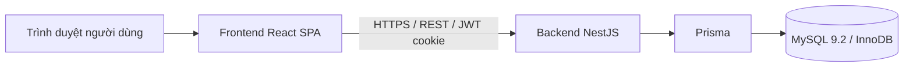

# Nhóm 3 CSE3045 — Tổ chức làm việc theo Scrum và kế hoạch Sprint 0

- **Đồ án:** Hoa Lac Food Ordering Platform — nền tảng tìm quán và đặt món cho sinh viên VJU khu Hòa Lạc
- **Môn học:** CSE3045 — Trường Đại học Việt Nhật (VJU)
- **Ngày lập:** 13/11/2026
- **Trưởng nhóm:** Nguyễn Nam Khánh
- **Thành viên:** Nguyễn Nam Khánh, Lê Quang Minh, Nguyễn Minh Đức

---

## 1. Thống nhất chọn Scrum làm quy trình phát triển

Cả 3 thành viên đã thống nhất chọn **Scrum** (đã học ở Buổi 4) làm quy trình phát triển cho đồ án.

### 1.1. Lý do chọn Scrum

| Đặc điểm của đồ án | Scrum giải quyết thế nào |
| --- | --- |
| Yêu cầu còn thay đổi trong quá trình làm (ví dụ: tháng 10 đã chuyển sang chỉ thanh toán COD, bỏ đặt đơn bằng QR) | Làm theo Sprint ngắn, cuối mỗi Sprint nhóm xem lại và sắp lại Product Backlog |
| Roadmap đã chia thành các phiên bản V0.1 → V1.0 | Mỗi Sprint gắn với một mục tiêu nhỏ, dễ đo, bám theo các phiên bản |
| Nhóm chỉ có 3 người, vừa học vừa làm | Daily Scrum ngắn giúp phát hiện việc bị kẹt sớm, không để dồn tới hạn nộp |
| Cần demo cho giảng viên định kỳ | Cuối mỗi Sprint luôn có một bản chạy được (Increment) để Sprint Review |

### 1.2. So sánh nhanh với các mô hình khác

| Mô hình | Lý do không chọn |
| --- | --- |
| Waterfall | Phải chốt toàn bộ yêu cầu từ đầu; đồ án thay đổi yêu cầu nhiều nên không phù hợp |
| Kanban thuần | Không có mốc Sprint và Sprint Goal rõ ràng, khó báo cáo tiến độ theo tuần cho môn học |
| Scrum | **Được chọn** — có nhịp tuần cố định, vai trò rõ ràng, phù hợp với báo cáo và demo theo buổi học |

### 1.3. Quy ước áp dụng Scrum của nhóm

| Thành phần | Quy ước |
| --- | --- |
| Độ dài Sprint | 1 tuần (khớp lịch học hằng tuần) |
| Sprint 0 | 13/11/2026 – 19/11/2026 |
| Sprint Planning | Đầu Sprint, 30 phút. Chọn việc từ Product Backlog, chốt Sprint Goal, ước lượng story point |
| Daily Scrum | Hằng ngày, tối đa 10 phút qua group chat hoặc gọi nhanh. Mỗi người trả lời 3 câu: hôm qua làm gì, hôm nay làm gì, có vướng gì không |
| Sprint Review | Cuối Sprint, demo bản chạy trên lớp hoặc trên link demo; giảng viên/nhóm khác góp ý |
| Sprint Retrospective | 15 phút sau Review: điều gì nên giữ, điều gì nên bỏ, điều gì sẽ thử ở Sprint sau |
| Backlog Refinement | Giữa Sprint, 20 phút: Product Owner làm rõ và tách nhỏ các việc của Sprint sau |
| Công cụ | GitHub Issues (mỗi việc là một Issue), GitHub Projects (bảng *To do / In progress / Review / Done*), Pull Request để review code |
| Ước lượng | Story point: 1 = nửa buổi, 2 = khoảng 1 ngày, 3 = 1–2 ngày, 5 = gần cả tuần |
| Năng lực Sprint 0 | Khoảng 30 story point cho 3 người |

### 1.4. Definition of Done (DoD)

Một việc chỉ được chuyển sang cột **Done** khi đủ các điều kiện:

1. Code được merge vào `main` qua Pull Request và có ít nhất 1 thành viên khác review.
2. `lint`, `build` và test liên quan đều chạy thành công.
3. Đáp ứng đủ tiêu chí chấp nhận ghi trong Issue.
4. Chạy được trên bản demo hoặc trên máy local theo hướng dẫn trong README.
5. Tài liệu liên quan (API, CSDL, hướng dẫn) đã được cập nhật.

---

## 2. Phân vai trò trong nhóm

### 2.1. Bảng phân vai

| Thành viên | Vai trò Scrum | Phụ trách kỹ thuật | Người dự phòng |
| --- | --- | --- | --- |
| **Nguyễn Nam Khánh** (trưởng nhóm) | Product Owner | Backend: NestJS, Prisma, MySQL, API, triển khai demo | Lê Quang Minh |
| **Lê Quang Minh** | Scrum Master / điều phối | Báo cáo, tài liệu, kiểm thử | Nguyễn Minh Đức |
| **Nguyễn Minh Đức** | Developer | Frontend: React, Vite, TypeScript, Tailwind CSS | Nguyễn Nam Khánh |

### 2.2. Trách nhiệm cụ thể

**Nguyễn Nam Khánh — Trưởng nhóm, Product Owner, Backend**

- Giữ và sắp xếp ưu tiên Product Backlog; viết user story và tiêu chí chấp nhận.
- Chốt Sprint Goal cùng nhóm trong Sprint Planning; chấp nhận hoặc trả lại kết quả ở Sprint Review.
- Thiết kế CSDL, viết API backend, migration, dữ liệu mẫu.
- Triển khai bản demo và hướng dẫn chạy local.
- Đại diện nhóm làm việc với giảng viên.

**Lê Quang Minh — Scrum Master / điều phối, Báo cáo & tài liệu**

- Tổ chức các buổi Sprint Planning, Daily Scrum, Sprint Review, Retrospective; giữ đúng thời lượng.
- Cập nhật bảng GitHub Projects, nhắc việc trễ, gỡ vướng mắc (blocker) cho thành viên.
- Viết báo cáo Sprint, biên bản họp, tài liệu yêu cầu và slide demo.
- Viết kịch bản kiểm thử thủ công và ghi lại kết quả test.

**Nguyễn Minh Đức — Developer Frontend**

- Xây dựng giao diện: trang chủ, danh sách quán, thực đơn, giỏ hàng, đặt đơn, trang quản lý đơn của quán.
- Kết nối giao diện với API backend; đảm bảo hiển thị tốt trên điện thoại.
- Thao tác demo các luồng người dùng trong Sprint Review.

### 2.3. Ma trận RACI cho Sprint 0

R = thực hiện, A = chịu trách nhiệm cuối cùng/phê duyệt, C = được hỏi ý kiến, I = được thông báo.

| Hạng mục | Khánh | Minh | Đức |
| --- | --- | --- | --- |
| Product Backlog và ưu tiên | A, R | C | C |
| Tổ chức các buổi Scrum, bảng công việc | I | A, R | I |
| Backend, API, CSDL | A, R | I | C |
| Frontend, giao diện | A | C | R |
| Kiểm thử | A | R | C |
| Báo cáo, tài liệu, slide | A | R | C |
| Demo trước lớp | A, R | R | R |

Vai Scrum Master có thể luân phiên ở các Sprint sau; người kế tiếp được ghi trong Issue lập kế hoạch Sprint.

---

## 3. Backlog Sprint 0

### 3.1. Sprint Goal

> Có nền tảng dự án chạy được và luồng MVP tối thiểu: **xem quán → chọn món → đặt đơn COD → quán nhận và xử lý đơn**, đủ để demo trước lớp.

### 3.2. User story cho MVP

| ID | User story |
| --- | --- |
| US-01 | Là **khách chưa đăng nhập**, tôi muốn xem danh sách quán và thực đơn để biết quán nào đang bán món gì, giá bao nhiêu. |
| US-02 | Là **sinh viên**, tôi muốn đăng ký và đăng nhập bằng email để đặt món. |
| US-03 | Là **sinh viên**, tôi muốn thêm món vào giỏ hàng và giỏ vẫn còn sau khi đăng nhập. |
| US-04 | Là **sinh viên**, tôi muốn đặt đơn trả tiền mặt (COD) và chọn điểm nhận cố định ở VJU. |
| US-05 | Là **chủ quán**, tôi muốn xem đơn mới và cập nhật trạng thái đơn (đã làm xong, đã giao, đã thu tiền). |
| US-06 | Là **sinh viên**, tôi muốn theo dõi trạng thái và xem lại lịch sử đơn của mình. |

### 3.3. Danh sách công việc Sprint 0

| ID | Việc cần làm | Story | Phụ trách | Ưu tiên | SP | Tiêu chí hoàn thành |
| --- | --- | --- | --- | --- | --- | --- |
| S0-01 | Tạo repo, bảo vệ nhánh `main`, tạo bảng GitHub Projects, mẫu Issue/PR | — | Lê Quang Minh | Cao | 1 | Mọi thành viên làm việc qua PR; bảng có 4 cột |
| S0-02 | Viết tài liệu yêu cầu MVP và mô tả 3 vai người dùng (người mua, chủ quán, Admin) | — | Nguyễn Nam Khánh | Cao | 2 | Nhóm duyệt `docs/requirements.md` |
| S0-03 | Dựng khung frontend Vite + React + TypeScript + Tailwind | — | Nguyễn Minh Đức | Cao | 2 | `npm run dev` hiển thị trang chủ; lint/build pass |
| S0-04 | Dựng khung backend NestJS + Prisma, kết nối MySQL 9.2 | — | Nguyễn Nam Khánh | Cao | 2 | `db:check` thành công; có migration đầu tiên |
| S0-05 | Thiết kế CSDL: User, Restaurant, Dish, Order, OrderItem, PickupPoint | — | Nguyễn Nam Khánh | Cao | 3 | Có ERD trong `docs/data/database.md`; `prisma validate` pass |
| S0-06 | Đăng ký / đăng nhập (JWT cookie, mã xác thực email) | US-02 | Khánh (API), Đức (giao diện) | Cao | 5 | Đăng ký, đăng nhập, đăng xuất chạy được trên trình duyệt |
| S0-07 | API và trang danh sách quán, thực đơn (không cần đăng nhập) | US-01 | Khánh (API), Đức (giao diện) | Cao | 3 | Khách vãng lai xem được quán và món từ dữ liệu thật |
| S0-08 | Giỏ hàng lưu tạm và giữ lại sau khi đăng nhập | US-03 | Nguyễn Minh Đức | Cao | 2 | Giỏ không mất khi đăng nhập; không tự động đặt đơn |
| S0-09 | Đặt đơn COD tại điểm nhận VJU | US-04 | Khánh (API), Đức (giao diện) | Trung bình | 5 | Đơn được lưu với giá chốt tại thời điểm đặt; bấm lại không tạo đơn trùng |
| S0-10 | Trang quản lý đơn của chủ quán | US-05 | Nguyễn Minh Đức | Trung bình | 3 | Chủ quán thấy đơn mới, chuyển được trạng thái đến “Hoàn thành” |
| S0-11 | Dữ liệu mẫu (3 quán, 15 món, 2 điểm nhận) và triển khai bản demo | — | Nguyễn Nam Khánh | Trung bình | 2 | Link demo mở được từ máy khác |
| S0-12 | Kịch bản kiểm thử thủ công cho US-01 → US-05 và ghi kết quả | US-01–05 | Lê Quang Minh | Trung bình | 2 | Mỗi story có ít nhất 1 ca kiểm thử với kết quả PASS/FAIL |
| S0-13 | Báo cáo Sprint 0, slide demo, danh sách rủi ro | — | Lê Quang Minh | Trung bình | 2 | Báo cáo nộp đúng hạn; mỗi rủi ro có người phụ trách |

**Tổng:** 34 story point — Khánh khoảng 15, Đức khoảng 12, Minh khoảng 7 cùng với việc điều phối. Nếu thiếu thời gian, nhóm dời S0-10 sang Sprint 1 trước.

**Để sau Sprint 0:** gợi ý món bằng AI, đối soát hoa hồng với quán, trang Admin đầy đủ, theo dõi đơn theo thời gian thực (US-06 làm ở Sprint 1).

### 3.4. Lịch Sprint 0

| Ngày | Hoạt động |
| --- | --- |
| Thứ Sáu 13/11 | Sprint Planning; làm S0-01, S0-02 |
| Thứ Bảy 14/11 – Chủ nhật 15/11 | S0-03, S0-04, S0-05 |
| Thứ Hai 16/11 – Thứ Ba 17/11 | S0-06, S0-07, S0-08; Backlog Refinement cho Sprint 1 |
| Thứ Tư 18/11 | S0-09, S0-10, S0-11, S0-12 |
| Thứ Năm 19/11 | S0-13; Sprint Review (demo) và Retrospective |

### 3.5. Rủi ro chính của Sprint 0

| Rủi ro | Ảnh hưởng | Cách xử lý | Phụ trách |
| --- | --- | --- | --- |
| Gửi email xác thực (SMTP) bị lỗi khi demo | Không đăng ký tài khoản mới được | Chuẩn bị sẵn tài khoản đã xác thực cho buổi demo | Nguyễn Nam Khánh |
| Frontend chờ API làm xong mới làm tiếp được | Trễ tiến độ giao diện | Thống nhất API trước, frontend dùng dữ liệu giả trong lúc chờ | Nguyễn Minh Đức |
| Link demo không truy cập được trên mạng của trường | Không demo được | Chạy local hoặc dùng ảnh chụp màn hình dự phòng | Lê Quang Minh |
| Ước lượng quá tay, không xong hết | Sprint Goal không đạt | Dời việc ưu tiên thấp (S0-10) sang Sprint 1 | Lê Quang Minh |

---

## 4. Demo nhanh ý tưởng / MVP cho lớp (5 phút)

Nhóm demo **bản chạy thật** tại <https://sv26.bcse-vju.com> (đã triển khai cho buổi demo ngày 24/10/2026).

**Ý tưởng:** sinh viên VJU ở Hòa Lạc khó biết quán nào gần trường còn mở, bán món gì, giá bao nhiêu; quán nhận đơn qua tin nhắn rời rạc. Nền tảng gom quán và thực đơn vào một chỗ, sinh viên đặt món, nhận tại điểm nhận cố định và trả tiền mặt cho quán.

### 4.1. Kịch bản demo

| Bước | Thời lượng | Nội dung | Người trình bày |
| --- | --- | --- | --- |
| 1 | 30 giây | Giới thiệu vấn đề và ý tưởng | Nguyễn Nam Khánh |
| 2 | 2 phút | **Người mua:** mở trang chủ khi chưa đăng nhập → xem danh sách quán → vào thực đơn → thêm món vào giỏ → đăng nhập (giỏ vẫn còn) → chọn điểm nhận VJU → xác nhận đơn COD | Nguyễn Minh Đức |
| 3 | 1 phút | **Chủ quán:** đăng nhập tài khoản quản lý quán → thấy đơn vừa đặt → báo món đã xong → đánh dấu đã giao và đã thu tiền | Nguyễn Minh Đức |
| 4 | 30 giây | **Người mua theo dõi:** quay lại trang đơn hàng, trạng thái đã cập nhật; mở lịch sử đơn | Nguyễn Minh Đức |
| 5 | 1 phút | Kiến trúc (React SPA → REST/JWT → NestJS → Prisma → MySQL), cách nhóm làm Scrum, kế hoạch Sprint 1 | Lê Quang Minh |

### 4.2. Kiến trúc hệ thống

### 4.3. Chuẩn bị trước buổi học

- [ ] Mở thử link demo trên mạng của trường và trên 4G
- [ ] Đăng nhập sẵn 2 tab: tài khoản người mua và tài khoản chủ quán (không chiếu mật khẩu lên màn hình)
- [ ] Phương án dự phòng: chạy local bằng `npm --prefix backend run dev` và `npm --prefix frontend run dev`, hoặc dùng 5 ảnh chụp màn hình của luồng demo
- [ ] Tập dượt 1 lần, giữ tổng thời gian dưới 5 phút

---

## 5. Kết quả mong đợi sau buổi hôm nay

- [x] Cả nhóm thống nhất dùng Scrum, Sprint 1 tuần
- [x] Phân vai rõ cho 3 thành viên: Khánh (trưởng nhóm, Product Owner, Backend), Minh (Scrum Master, báo cáo/tài liệu), Đức (Frontend)
- [x] Có backlog Sprint 0 gồm 13 việc, 34 story point, có người phụ trách và tiêu chí hoàn thành
- [ ] Demo MVP trước lớp và ghi lại góp ý vào Sprint Review
