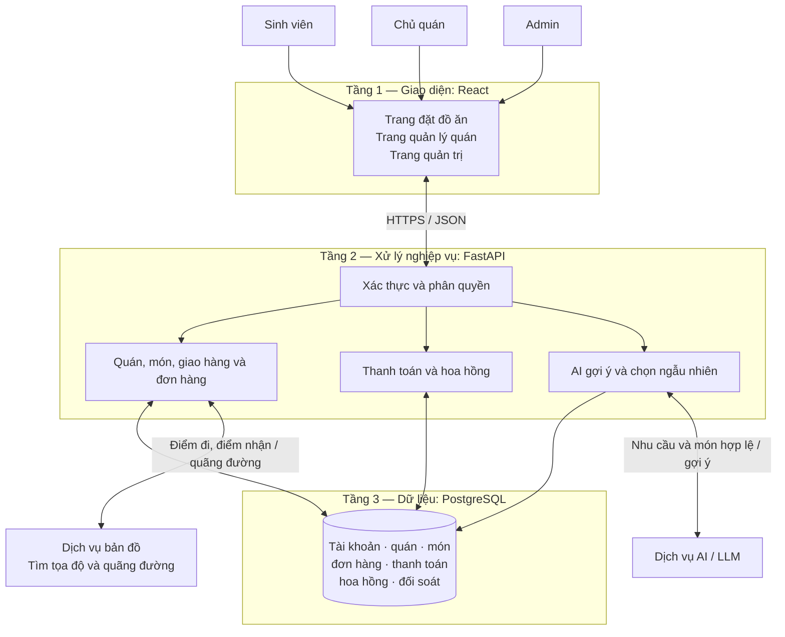
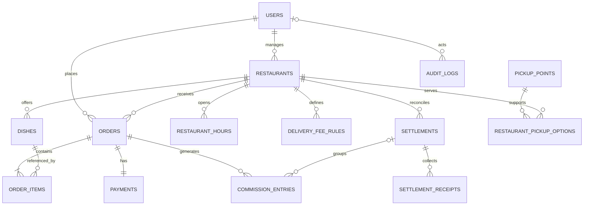

# Thiết kế hệ thống — Website đặt đồ ăn tại Hòa Lạc

## 1. Phạm vi và phương án thiết kế

Thiết kế cho **toàn bộ sản phẩm đã phân tích**, gồm sinh viên, chủ quán và admin. MVP tại VJU là giai đoạn triển khai đầu tiên.

Tài liệu thiết kế sẽ được lưu tại `docs/thiet-ke-he-thong.md`, gồm:

- Sơ đồ kiến trúc 3 tầng và luồng xử lý.
- Đặc tả **5 endpoint REST tiêu biểu**, kèm danh mục API bổ sung.
- Sơ đồ quan hệ CSDL, các bảng chính và quy tắc bảo toàn dữ liệu.

Công nghệ đã chọn: **React — FastAPI — PostgreSQL**. React phụ trách giao diện; FastAPI cung cấp API và hỗ trợ tài liệu API theo OpenAPI. Tham khảo [React](https://react.dev/learn) và [FastAPI](https://fastapi.tiangolo.com/features/).

Các giả định thiết kế:

- Một chủ quán có thể quản lý nhiều quán; mỗi quán có một tài khoản chủ quán phụ trách.
- Một đơn hàng chỉ thuộc một quán.
- Quán tự giao; không có tài khoản tài xế trong phạm vi hiện tại.
- Chưa chọn nhà cung cấp AI hoặc bản đồ; xác định trước dữ liệu cần gửi và nhận để có thể lựa chọn sau.

## 2. Sơ đồ kiến trúc 3 tầng

| Tầng                | Trách nhiệm                                                                                                              |
| ------------------- | ------------------------------------------------------------------------------------------------------------------------ |
| **Giao diện**       | Hiển thị thông tin, thu nhận lựa chọn và gửi yêu cầu. Có các màn hình phù hợp với từng vai trò.                          |
| **Xử lý nghiệp vụ** | Kiểm tra quyền, tính tiền và phí giao, kiểm tra trạng thái đơn, xác nhận thanh toán, tính hoa hồng và gọi dịch vụ ngoài. |
| **Dữ liệu**         | Lưu thông tin, duy trì quan hệ giữa các bảng và bảo đảm các cập nhật liên quan được thực hiện nhất quán.                 |

Frontend không kết nối trực tiếp PostgreSQL. Các khóa bí mật của dịch vụ ngoài được giữ ở backend. Bản đồ hiển thị ở giao diện có thể dùng khóa công khai được giới hạn phù hợp nếu nhà cung cấp yêu cầu.

Ba tầng là cách phân chia trách nhiệm, **không bắt buộc phải triển khai trên ba máy chủ riêng**.

**Luồng đặt hàng**

1. Sinh viên chọn quán, món và điểm nhận.
2. Backend xác định quãng đường, kiểm tra phạm vi giao và trả phí.
3. Giao diện hiển thị tiền món, phí giao và tổng tiền.
4. Sinh viên xác nhận; backend kiểm tra lại giá, món và điều kiện giao.
5. Backend lưu đơn, các dòng món và thông tin thanh toán trong cùng một giao dịch CSDL.
6. Quán tiếp nhận và cập nhật tiến độ.
7. Khi đơn hoàn thành, backend ghi nhận hoa hồng đúng một lần.

**Luồng gợi ý**

Backend lọc những món có thể đặt trước, rồi gửi danh sách đó cùng nhu cầu cho AI. Kết quả phải được đối chiếu lại với dữ liệu thật; AI không quyết định giá, phí giao hay tự tạo đơn.

Chọn ngẫu nhiên dùng cùng bộ lọc nhưng không cần gọi AI.

## 3. Thiết kế REST API

### 3.1. Quy ước chung

- Tiền tố đường dẫn: `/api/v1`.
- Dữ liệu trao đổi: JSON; giá tiền biểu diễn bằng số nguyên VNĐ.
- Backend xác định người dùng từ thông tin xác thực, không tin `user_id` hay `role` tự gửi trong nội dung yêu cầu.
- Danh sách hỗ trợ phân trang bằng `page`, `page_size`; mặc định 20, tối đa 100 phần tử/trang.
- Lỗi dùng cấu trúc thống nhất: `error.code`, `error.message`, `error.details`.
- `401`: chưa xác thực; `403`: thiếu quyền; `404`: không tìm thấy; `409`: xung đột giá hoặc trạng thái; `422`: dữ liệu không hợp lệ; `503`: dịch vụ phụ thuộc tạm thời không đáp ứng.

`GET` dùng để đọc dữ liệu, không dùng để xóa hoặc cập nhật. Tính “an toàn” trong HTTP nói về thay đổi trạng thái do thao tác yêu cầu, không phải mức độ bảo mật. Tham khảo [RFC 9110](https://www.rfc-editor.org/rfc/rfc9110.html#name-safe-methods).

### 3.2. Năm endpoint đặc tả chi tiết

| #   | Method và endpoint                       | Mục đích, quyền                                                                       | Dữ liệu vào                                                                                                                        | Dữ liệu trả về                                                                                                     |
| --- | ---------------------------------------- | ------------------------------------------------------------------------------------- | ---------------------------------------------------------------------------------------------------------------------------------- | ------------------------------------------------------------------------------------------------------------------ |
| 1   | `GET /api/v1/restaurants`                | Xem, tìm quán; được xem công khai.                                                    | `q`, `page`, `page_size`.                                                                                                          | `200`: danh sách mã quán, tên, địa chỉ, ảnh, giờ bán, trạng thái nhận đơn và thông tin phân trang.                 |
| 2   | `GET /api/v1/dishes`                     | Tìm món trên toàn hệ thống hoặc trong một quán; được xem công khai.                   | `restaurant_id`, `q`, `category`, `min_price`, `max_price`, phân trang.                                                            | `200`: mã món, quán, tên, mô tả, giá, ảnh, loại món và tình trạng phục vụ.                                         |
| 3   | `POST /api/v1/orders`                    | Sinh viên tạo đơn hàng.                                                               | Quán, danh sách `dish_id` và số lượng, điểm nhận, số liên hệ, ghi chú, phương thức thanh toán và các giá/phí đã được khách đồng ý. | `201`: mã đơn, trạng thái, tiền món, phí giao, tổng tiền, phương thức và trạng thái thanh toán.                    |
| 4   | `PATCH /api/v1/orders/{order_id}/status` | Chủ quán cập nhật đơn của quán mình; sinh viên chỉ được hủy đơn của mình khi còn chờ. | `status`, `reason` khi hủy hoặc từ chối.                                                                                           | `200`: trạng thái mới và thời điểm cập nhật; `409` nếu chuyển trạng thái không hợp lệ.                             |
| 5   | `POST /api/v1/recommendations`           | Sinh viên nhận gợi ý AI.                                                              | Ngân sách tiền món, sở thích, loại món muốn tránh và điểm nhận.                                                                    | `200`: danh sách món hợp lệ, giá hiện tại, phí giao riêng và lý do gợi ý; danh sách rỗng nếu không có món phù hợp. |

**Quy tắc cho từng endpoint**

- Endpoint 1–2 không hiển thị quán ngừng hoạt động hoặc món đã ẩn trong danh sách công khai. Quán tạm đóng cửa hoặc món hết hàng được ghi rõ, không cho đặt.
- Endpoint 3 kiểm tra tất cả món thuộc cùng quán. Backend tự tính tiền; nếu giá hoặc phí thay đổi so với phần khách đã đồng ý thì trả `409` để khách xem và xác nhận lại.
- Endpoint 3 yêu cầu `Idempotency-Key` để chống tạo đơn trùng. Cùng người dùng, cùng khóa và cùng nội dung trả lại đơn đã tạo; dùng lại khóa với nội dung khác trả `409`.
- Endpoint 4 cập nhật trạng thái và phát sinh hoa hồng trong cùng giao dịch CSDL. Gửi lại trạng thái hiện tại không tạo thêm hoa hồng hoặc sự kiện chuyển trạng thái.
- Endpoint 5 không gửi tên, số điện thoại hoặc địa chỉ chi tiết cho AI; việc kiểm tra giao hàng do backend thực hiện trước. Khi AI lỗi, trả thông báo phù hợp và giao diện vẫn cho chọn món thủ công.

| Endpoint                    | An toàn theo HTTP?                     | Tính idempotent                                                             |
| --------------------------- | -------------------------------------- | --------------------------------------------------------------------------- |
| Hai endpoint `GET`          | Có                                     | Có                                                                          |
| `POST /orders`              | Không                                  | Có cơ chế chống lặp bằng khóa; bản thân POST không mặc định idempotent.     |
| `PATCH /orders/{id}/status` | Không                                  | Được thiết kế để gửi lại cùng trạng thái không tạo thêm tác động nghiệp vụ. |
| `POST /recommendations`     | Không được bảo đảm theo ngữ nghĩa POST | Không bảo đảm cùng kết quả giữa các lần gọi.                                |

### 3.3. Danh mục API bổ sung

Năm endpoint trên là phần đặc tả tiêu biểu, không phải toàn bộ API sản phẩm.

| Nhóm                        | Các endpoint bổ sung                                                                                                                                     |
| --------------------------- | -------------------------------------------------------------------------------------------------------------------------------------------------------- |
| Tài khoản                   | `POST /auth/register`, `POST /auth/login`, `POST /auth/logout`, `GET /users/me`, `PATCH /users/me`.                                                      |
| CRUD quán                   | `POST /restaurants`, `GET /restaurants/{id}`, `PATCH /restaurants/{id}`, `DELETE /restaurants/{id}`.                                                     |
| CRUD món                    | `POST /restaurants/{id}/dishes`, `GET /dishes/{id}`, `PATCH /dishes/{id}`, `DELETE /dishes/{id}`.                                                        |
| Màn hình quản lý            | `GET /management/restaurants`, `GET /management/restaurants/{id}/dishes`; trả cả dữ liệu đã ẩn khi người gọi có quyền.                                   |
| Chính sách giao             | `GET /restaurants/{id}/delivery-policy`, `PUT /restaurants/{id}/delivery-policy`.                                                                        |
| Tìm địa điểm, báo phí       | `GET /locations/search`, `POST /delivery-quotes`; trả tọa độ hoặc quãng đường, khả năng giao và phí.                                                     |
| Đơn hàng                    | `GET /orders`, `GET /orders/{id}`; tự giới hạn dữ liệu theo người dùng/quán.                                                                             |
| Thanh toán                  | `GET /orders/{id}/payment`, `PATCH /orders/{id}/payment`; chỉ quán sở hữu đơn xác nhận nhận tiền hoặc ghi nhận đã hoàn tiền.                             |
| Cấu hình hoa hồng           | `PATCH /restaurants/{id}/commission-policy`; chỉ admin.                                                                                                  |
| Theo dõi hoa hồng           | `GET /restaurants/{id}/commissions`, `GET /admin/commissions`.                                                                                           |
| Đối soát, thu tiền          | `POST /settlements`, `GET /settlements`, `GET /settlements/{id}`, `POST /settlements/{id}/receipts`; admin ghi nhận thu tiền, quán được xem kỳ của mình. |
| Điều chỉnh đối soát         | `POST /commission-adjustments`; admin thực hiện, bắt buộc có lý do và lịch sử.                                                                           |
| Chọn ngẫu nhiên — Should    | `POST /random-selections`.                                                                                                                               |
| Hỗ trợ — Should             | `POST /support-tickets`, `GET /support-tickets`, `PATCH /support-tickets/{id}`.                                                                          |
| Đánh giá, yêu thích — Could | Nhóm `/reviews` và `/favorites`, thiết kế chi tiết khi triển khai phần mở rộng.                                                                          |

Tất cả đường dẫn trong bảng dùng tiền tố `/api/v1`.

Quyền CRUD giữ nguyên bản phân tích: admin tạo/xóa quán; chủ quán quản lý món của mình và chỉ sửa thông tin vận hành được phép. API xóa trả rõ kết quả **đã xóa** hoặc **đã chuyển sang ẩn/ngừng hoạt động**.

### 3.4. Trạng thái nghiệp vụ

- **Đơn hàng:** `pending → accepted → delivering → completed`.
- Nhánh kết thúc khác: `pending → cancelled` hoặc `pending → rejected`.
- **Thanh toán:** `unpaid`, `paid`, `refund_pending`, `refunded`.
- **Đối soát:** `open`, `partially_paid`, `paid`.

Trạng thái thanh toán và đối soát được quản lý riêng với trạng thái đơn. Các yêu cầu hủy sau khi quán đã nhận được chuyển sang hỗ trợ; không cho sinh viên tự đổi trạng thái.

## 4. Lược đồ CSDL

### 4.1. Sơ đồ quan hệ chính

`PK` là khóa chính, dùng nhận diện duy nhất một bản ghi. `FK` là khóa ngoại, liên kết đến bản ghi ở bảng khác. Các ràng buộc khóa và quan hệ được thể hiện bằng cơ chế của [PostgreSQL](https://www.postgresql.org/docs/current/ddl-constraints.html).

### 4.2. Các bảng và trường chính

| Bảng                          | Trường chính và ý nghĩa                                                                                                                                                                                                                                                                                                     |
| ----------------------------- | --------------------------------------------------------------------------------------------------------------------------------------------------------------------------------------------------------------------------------------------------------------------------------------------------------------------------- |
| **users**                     | `id PK`, `full_name`, `email UNIQUE`, `phone`, `password_hash`, `role`, `status`, `created_at`. Vai trò: sinh viên, chủ quán, admin.                                                                                                                                                                                        |
| **restaurants**               | `id PK`, `owner_id FK → users`, `name`, `description`, `address`, `latitude`, `longitude`, `phone`, `image_url`, `status`, `accepting_orders`, `max_delivery_distance_m`, `commission_rate`, thông tin tài khoản ngân hàng và QR.                                                                                           |
| **restaurant_hours**          | `id PK`, `restaurant_id FK`, `weekday`, `opens_at`, `closes_at`. Một quán có thể có nhiều khung giờ mỗi ngày.                                                                                                                                                                                                               |
| **dishes**                    | `id PK`, `restaurant_id FK`, `name`, `description`, `category`, `price_vnd`, `image_url`, `status`, `created_at`, `updated_at`.                                                                                                                                                                                             |
| **delivery_fee_rules**        | `id PK`, `restaurant_id FK`, `min_distance_m`, `max_distance_m`, `fee_vnd`. Lưu mức phí theo từng khoảng cách.                                                                                                                                                                                                              |
| **orders**                    | `id PK`, `student_id FK → users`, `restaurant_id FK`, trạng thái đơn; tên quán, địa chỉ nhận, tọa độ, người nhận và số điện thoại tại lúc đặt; `distance_m`, `subtotal_vnd`, `delivery_fee_vnd`, `total_vnd`, `commission_rate_snapshot`, `note`, `idempotency_key`, `request_hash`, các thời điểm tạo/cập nhật/hoàn thành. |
| **order_items**               | `id PK`, `order_id FK`, `dish_id FK`, `dish_name_snapshot`, `unit_price_vnd`, `quantity`. Lưu tên và giá tại lúc đặt.                                                                                                                                                                                                       |
| **payments**                  | `id PK`, `order_id FK UNIQUE`, `method`, `status`, `amount_vnd`, thông tin tài khoản nhận tiền tại lúc đặt, `confirmed_by FK → users`, `paid_at`, `refunded_at`.                                                                                                                                                            |
| **commission_entries**        | `id PK`, `order_id FK`, `settlement_id FK` có thể trống, `entry_type`, `amount_vnd`, `reason`, `created_by FK → users` có thể trống với tác vụ hệ thống, `created_at`. Gồm khoản hoa hồng gốc và khoản điều chỉnh.                                                                                                          |
| **settlements**               | `id PK`, `restaurant_id FK`, `period_start`, `period_end`, `status`, `created_at`, `closed_at`. Một kỳ đối soát của một quán.                                                                                                                                                                                               |
| **settlement_receipts**       | `id PK`, `settlement_id FK`, `amount_vnd`, `received_at`, `recorded_by FK → users`, `reference`, `request_key UNIQUE`. Ghi nhận các lần admin đã thu hoa hồng.                                                                                                                                                              |
| **audit_logs**                | `id PK`, `actor_id FK → users` có thể trống, `action`, `entity_type`, `entity_id`, `before_data`, `after_data`, `created_at`. Lưu thay đổi để truy vết.                                                                                                                                                                     |
| **pickup_points**             | `id PK`, `name`, `address`, `latitude`, `longitude`, `active`. Điểm nhận cố định cho MVP.                                                                                                                                                                                                                                   |
| **restaurant_pickup_options** | `restaurant_id FK`, `pickup_point_id FK`, `distance_m`, `delivery_fee_vnd`, `enabled`. Cặp quán–điểm nhận là khóa duy nhất.                                                                                                                                                                                                 |

Các bảng mở rộng:

- **Should:** `support_tickets`, liên kết người gửi, đơn hàng, nội dung và trạng thái xử lý.
- **Could:** `reviews`, liên kết đơn hoàn thành và người đánh giá; `favorite_dishes`, `favorite_restaurants`, liên kết người dùng với món/quán.
- Lịch sử đặt hàng đọc từ `orders`; đặt lại tạo giỏ mới từ `order_items`.
- Chọn ngẫu nhiên không cần bảng riêng. Chưa lưu hội thoại AI hoặc dữ liệu huấn luyện trong phạm vi này.

### 4.3. Quy tắc dữ liệu

- Mã định danh dùng `BIGINT`; tiền dùng số nguyên VNĐ; tỷ lệ phần trăm dùng `NUMERIC(5,2)`; thời điểm dùng `TIMESTAMPTZ`.
- Giá, phí và số tiền thanh toán không âm; số lượng món lớn hơn 0; tỷ lệ hoa hồng từ 0 đến 100.
- Khoảng phí giao không chồng lấn. Ranh giới dùng `[min, max)`, riêng khoảng cuối bao gồm khoảng cách tối đa.
- Hoa hồng được tính từ tiền món và tỷ lệ đã lưu theo đơn, làm tròn đến đồng; phần lẻ từ 0,5 đồng làm tròn lên.
- Mỗi đơn chỉ có một khoản hoa hồng gốc. Điều chỉnh tạo dòng riêng có lý do, không ghi đè lịch sử.
- Một khoản hoa hồng chỉ thuộc tối đa một kỳ đối soát; mọi khoản trong kỳ phải thuộc cùng quán.
- Số phải thu là tổng các khoản hoa hồng và điều chỉnh; số đã thu là tổng biên nhận; còn phải thu bằng phần chênh lệch.
- Tạo đơn và các dòng món trong một giao dịch CSDL. Chuyển đơn sang hoàn thành và tạo khoản hoa hồng cũng thực hiện trong một giao dịch.
- Không xóa món/quán đã có đơn. Giữ khóa ngoại và dữ liệu chụp tại thời điểm đặt để lịch sử không đổi khi cập nhật danh mục.
- Giỏ hàng được giữ ở giao diện trong thiết kế ban đầu; backend vẫn kiểm tra lại toàn bộ khi tạo đơn.
- Tạo chỉ mục cho khóa ngoại và các truy vấn thường dùng: đơn theo sinh viên/quán và thời gian, món theo quán, khoản hoa hồng theo đơn và kỳ.
- Nhật ký không lưu mật khẩu, khóa bí mật hoặc toàn bộ dữ liệu nhạy cảm không cần thiết.

## 5. Kiểm tra tính nhất quán và giới hạn bàn giao

Tài liệu được coi là hoàn thành khi có đủ sơ đồ ba tầng, năm endpoint chi tiết, danh mục API bổ sung, sơ đồ quan hệ và bảng mô tả dữ liệu.

Các tình huống dùng để kiểm tra thiết kế:

1. Một đơn có nhiều món nhưng tất cả thuộc cùng quán.
2. Quán đổi tên món hoặc giá; đơn cũ vẫn giữ tên và giá lúc đặt.
3. Khách gửi lại yêu cầu tạo đơn; hệ thống trả đơn cũ thay vì tạo trùng.
4. Sinh viên hủy đúng lúc quán xác nhận; chỉ một chuyển trạng thái hợp lệ được ghi nhận.
5. Gửi lặp trạng thái hoàn thành không tạo thêm hoa hồng.
6. Khách báo chuyển khoản chưa làm thanh toán tự chuyển sang `paid`.
7. Thay đổi tỷ lệ hoa hồng không sửa khoản của đơn đã chốt.
8. Chủ quán không xem hoặc sửa được dữ liệu của quán khác.
9. Món hết hàng, điểm ngoài vùng giao hoặc bản đồ lỗi không dẫn đến đơn với phí đoán.
10. Ngừng hoạt động quán vẫn giữ đơn đang xử lý, lịch sử và số tiền cần đối soát.
11. Khoản hoa hồng đã đưa vào một kỳ không được đưa lại vào kỳ khác.
12. AI chỉ trả món hợp lệ; lỗi AI không chặn việc đặt món thủ công.

Bước này bàn giao **tài liệu thiết kế**, chưa tạo ứng dụng, chạy CSDL hay triển khai website. Tên dịch vụ AI, nhà cung cấp bản đồ và cấu hình máy chủ sẽ được chốt trước giai đoạn lập trình.
